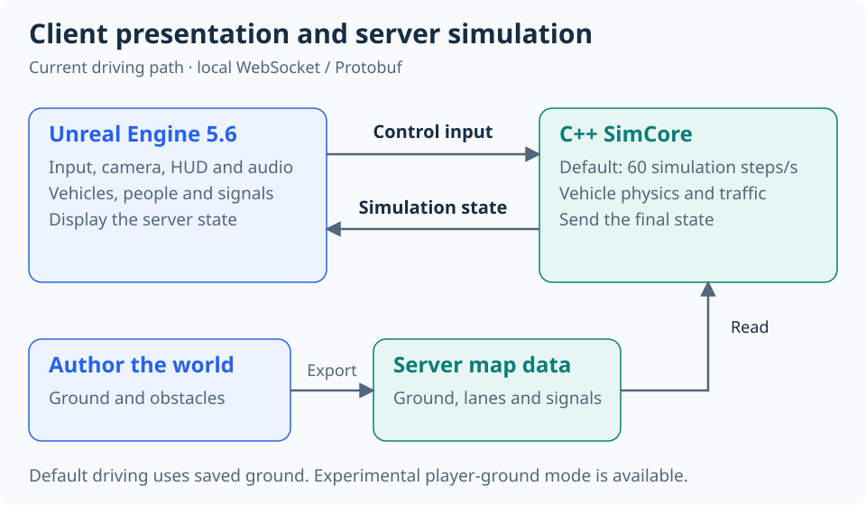

# Drive Integration

[English](README.md) | [한국어](README.ko.md)

A Windows driving simulation built with **Unreal Engine 5.6** and a separate **C++ simulation server**.

Unreal handles input and presentation. SimCore calculates vehicle motion and traffic at a default rate of 60 steps per second. Vehicle dynamics use custom equations, without an external vehicle physics SDK.

## Features

| Area | What is implemented |
|---|---|
| Driving | Acceleration, reverse, steering, braking, four-wheel ground contact and suspension |
| Vehicles | Sedan, compact car, truck and motorcycle; shared JSON settings |
| Parts | Two sedan presets and individual tire, suspension and powertrain selections |
| Traffic | 10 NPC vehicles, 8 pedestrians, signals, route selection and obstacle avoidance |
| Collisions | Vehicle impacts, local body deformation, pedestrian falls and structure damage |
| Presentation | Dashboard, three camera modes, drivers, lights, horn, vehicle audio and exhaust |
| Diagnostics | Ground/contact debug view, visual recording/playback and server physics replay |

The city is a fictional test course inspired by some Korean road rules, not a complete road-system simulation.

## How it works



The server owns the final vehicle state. The current driving path uses ground, obstacle and traffic data exported from Unreal. These files are called **MapPackage** in the code.

A transition to live Unreal world queries is in progress. Optional modes use Unreal measurements for player ground, box obstacles, and NPC/pedestrian ground. Normal startup still uses saved map data. The live modes remain experimental. [Scope and limits — Korean](docs/architecture.md#실시간-월드-측정-전환-계획)

## Requirements

- Windows 64-bit
- Unreal Engine 5.6
- Visual Studio 2022 with **Desktop development with C++**
- CMake 3.21 or later, Git and PowerShell

Python is not needed to run the game or server. Some development tests use it.

## Quick start

Run these commands in PowerShell from the repository root:

```powershell
.\cpp\host\scripts\setup.ps1
.\cpp\host\scripts\build.ps1
.\scripts\run_signal_city_server.ps1 -Background
```

The setup script prepares the project-local vcpkg dependencies. The build creates `cpp\host\build\Release\simcore_publisher.exe`.

1. Open `unreal\DriveIntegration\DriveIntegration.uproject` in Unreal Engine 5.6.
2. Build the C++ modules if the editor prompts you.
3. Open `/Game/SignalCity/Maps/L_SignalCity` and press **Play**.
4. Check that the HUD connection status is **Active**.

The saved map is ready to use; you do not need to Bake it again for normal Play.

The launcher prints the server PID and log paths. Logs are saved in `runtime_logs/`. To stop that server:

```powershell
Stop-Process -Id <PID>
```

Only one server can use port 9000 at a time. Remove `-Background` to keep the server log in the current terminal.

### Optional live ground comparison

Stop the existing server, then start the diagnostic mode:

```powershell
.\scripts\run_signal_city_server.ps1 -Background -GroundQueryShadow
```

Play with the rebuilt Unreal client. The server's `[GroundShadow]` log reports response time and ground differences. This is a development check, not the completed live-physics mode. [Scope and checks — Korean](docs/guides/core_validation.md#실시간-지면-측정-비교)

### Experimental player ground

Stop the existing server and start `scripts/run_signal_city_server.ps1 -Background -LiveGround`.
Use the rebuilt Unreal client. This mode samples a small area around the player and runs the existing server physics on those measurements. It needs no ground Bake for that area.

This mode measures straight curb edges and adjusts the scan area to vehicle speed. Missing, expired, or ambiguous measurements pause the affected simulation. World changes invalidate old results; server physics recording includes the measurements actually used.

Add `-LiveObstacles` for supported box obstacles and `-LiveNpcGround` for NPC/pedestrian ground. These flags also enable `-LiveGround`. Unsupported obstacle shapes pause the experimental simulation; they are not treated as empty space. Saved map data is still required at startup and for traffic rules and structure damage. Ground comparison cannot run at the same time. General curb/high-speed driving, overlapping surfaces, and the new packaged build still need acceptance testing. [Test guide — Korean](docs/guides/core_validation.md#실험용-플레이어-지면)

## Controls

| Input | Action |
|---|---|
| `W` / `S` | Accelerate / brake; hold S after stopping to reverse |
| `A` / `D` | Steer left / right |
| `Space` | Rear-wheel handbrake |
| `Q` / `E` / `X` | Left indicator / right indicator / hazard lights |
| `H` | Horn while held |
| `1` / `2` / `3` / `4` | Sedan / compact / truck / motorcycle; resets the drive |
| `G` | Open or close the vehicle setup menu |
| `↑` / `↓` / `Enter` | Select a preset or slot / apply while stopped |
| `Tab` / `←` / `→` in the menu | Switch to individual parts / change the selected part |
| Mouse / mouse wheel | Rotate camera / change camera distance |
| `V` / `C` | Cycle three camera modes / return to the chase camera |
| `F3` | Ground and collision debug view |
| `R` / `F6` | Start or stop recording / play the last visual recording |

Applying a vehicle setup starts a new drive at the spawn point. Reconnecting during the same drive keeps the selected setup and simulation state.

## Tests

After building the server:

```powershell
Set-Location .\cpp\host
ctest --preset release
Set-Location ..\..
```

See [validation tools — Korean](scripts/README.md) for protocol, Unreal and integration checks. Automated checks do not replace manual driving, visual/audio review or a 30-minute stability run.

## Limits and current work

- Vehicle physics are simplified and are not calibrated to a specific real car. Motorcycle balance is also simplified.
- NPCs use route and obstacle rules; they do not interpret camera images or run the full player suspension model.
- Individual parts are available through the catalog. The comparison presets are currently sedan-only. Part mass is not added to total vehicle mass or inertia.
- Visual dents do not deform the server's collision shape.
- Only a server on the same PC is supported: `ws://127.0.0.1:9000/` by default.
- Live queries do not yet replace ground or collision Bake data. Final driving and packaged-build acceptance remain separate tasks.

To change the local server address, copy `unreal\DriveIntegration\SimCoreClient.example.ini` to `SimCoreClient.ini` in the same folder, edit `ServerUrl`, then restart Play.

## Repository and documentation

| Folder | Purpose |
|---|---|
| `cpp/host/` | C++ server, physics, traffic and tests |
| `unreal/DriveIntegration/` | Unreal project, maps, assets and shared vehicle catalog |
| `protocol/` | Protobuf message definitions |
| `map_packages/` | Current server-side ground, collision and traffic data |
| `scripts/` | Windows launchers and development checks |
| `docs/` | Architecture, current status, guides and asset sources |

Detailed documentation is currently in Korean:

- [Current status and remaining work](docs/status.md)
- [Architecture and vehicle settings](docs/architecture.md)
- [Windows packaging](docs/guides/windows_package.md)
- [Asset sources](docs/assets/README.md)
- [Documentation index](docs/README.md)

Study materials and old build outputs are stored outside this repository. Generated builds, caches, logs and personal settings are excluded from Git.
