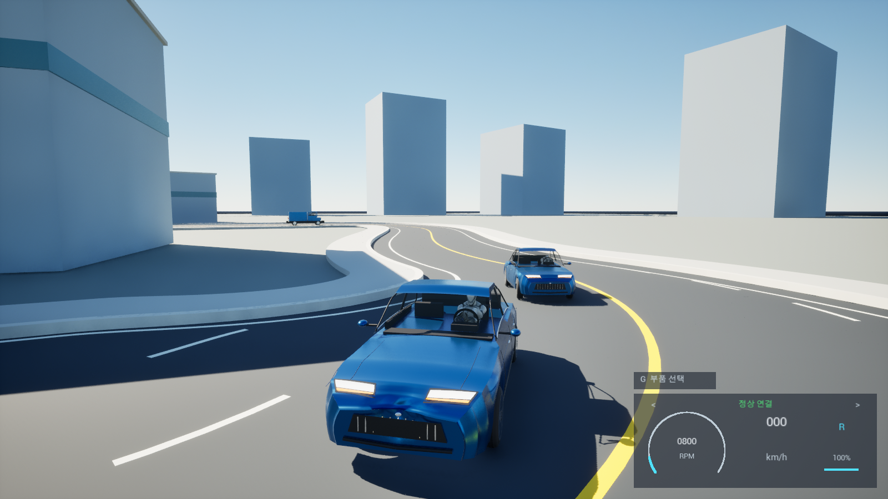
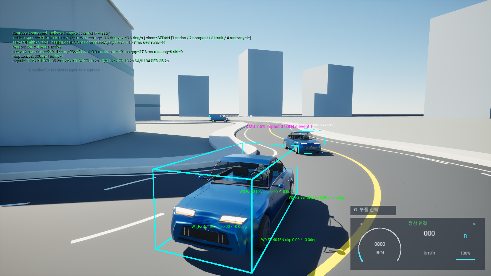

# Drive Integration

[English](README.md) | [한국어](README.ko.md)

**A personal project implementing vehicle driving, state synchronization and debugging with Unreal Engine 5.6 and a C++ server.**

## 1. Project overview

This Windows driving simulation calculates control input on a server and displays the results in Unreal. Alongside vehicle movement, the project focuses on **how data travels through the system and how to investigate problems**.

It builds on my professional experience in **packet communication, serialization and overall software architecture design**. The **debug view for collision and connection state was added in this personal project**.

### What currently runs

| Area | Implemented features |
|---|---|
| Driving | Sedan, compact car, truck and motorcycle selection; acceleration, braking, steering, reverse, ground contact and collisions |
| City traffic | Roads with signals, NPC vehicles and pedestrians, obstacle avoidance and collision responses |
| Vehicle setup | File-based vehicle and part data, with a menu to select and apply parts while stopped. Comparison setups currently focus on the sedan |
| Inspection tools | Speed and connection HUD, collision and wheel-contact debugging, drive recording and playback |

**Current scope:** This is a development project with the client and server running on the same PC. Vehicle physics and NPC behavior use simplified models. It is not a completed online multiplayer game or a simulator validated against real cars. Body deformation is visual and does not change the server collision shape. Live ground and obstacle queries are experimental. Driving feel, visuals and long-session checks of the latest build remain open.

## 2. Implementation work

### Packet communication and data processing

**WebSocket provides the connection for sending data. Protobuf defines how data is represented as bytes.** [vehicle.proto](protocol/vehicle.proto) defines the messages. The implementation covers the path from sending control input to applying received state to vehicles.

1. **Check compatibility — `Hello`**

   On connection, message versions and supported features are checked to confirm client and server compatibility. A successful socket connection alone does not guarantee that both sides understand the same data. For example, `vehicle-loadout.v1` indicates support for vehicle part setups. Driving does not start if a required format or feature is incompatible.

2. **Send input — `ControlCommand`**

   Throttle, brake and steering values are converted into bytes for transmission. This is **serialization**. The server reads the bytes back into values through **deserialization**, then validates the input and the right to control the current drive.

3. **Send simulation results — `WorldState`**

   The server calculates position, speed, wheel state and other results, then sends updates periodically. The client applies a continuing stream of state instead of waiting for one reply to each input.

4. **Apply state to Unreal objects**

   Received fragments are assembled into a complete message. Size, drive identity and sequence are checked before valid state is applied to vehicles and the HUD on the game thread. This prevents data from an earlier drive from overwriting the current vehicle state.

`Hello` is an initial compatibility message defined by this project, not login authentication. The server uses generated Protobuf code. The Unreal client implements reading and writing the Protobuf format needed by this project.

Code: [Message serialization](unreal/DriveIntegration/Source/DriveIntegration/SimCoreProtocol.cpp) · [Client connection and reception](unreal/DriveIntegration/Source/DriveIntegration/SimCoreClientComponent.cpp) · [Server transport](cpp/host/src/websocket/ws_server.cpp)

### Connection and drive state management

A brief connection loss is handled separately from starting a new drive. **Reconnecting within the same Play preserves the drive; a new Play resets it.** Sequence checks reject old or already processed state.

The server also keeps only **the state being sent and one latest pending state**. New state replaces an unsent update so old updates do not keep accumulating when transmission falls behind. Unreal displays the latest state with short-term motion prediction.

### Vehicle settings separated from code

JSON files hold vehicle settings such as mass, dimensions and wheels. Engines, tires and suspension parts are selected by ID, so different parts can change the values used to simulate the same vehicle type.

The client and server check that they use matching settings, and incompatible setups are checked before application. Recalculating total vehicle mass from replaced parts is not yet implemented.

Code and data: [Vehicle settings](cpp/host/config/vehicles/catalog.json) · [Unreal catalog reader](unreal/DriveIntegration/Source/DriveIntegration/SimCoreVehicleCatalog.cpp) · [Part structure and supported scope](docs/architecture.md)

## 3. Architecture and setup

### Runtime screenshot



*Captured on 2026-10-30 in Unreal Engine 5.6's game window, connected to the local C++ server. The scene shows the player vehicle, NPC traffic, city roads and the HUD's active connection indicator. Default file-based mode; original 1600×900 capture.*

### System structure


*Architecture diagram for the default execution mode.*

| Component | Responsibility |
|---|---|
| Unreal client | Collect input, receive server state, and display vehicles, camera, HUD and audio |
| C++ SimCore server | Validate input, simulate vehicles and traffic, and send final state |
| Shared data | Message definitions, vehicle and part settings, and server ground, road and signal data |

The server decides the final vehicle position and motion. Separating simulation from presentation makes it easier to trace a driving issue to server calculation, communication or display.

The server runs at **60Hz, or 60 simulation steps per second**, by default. This is separate from screen frame rate (FPS). The default mode reads ground and traffic files exported from Unreal. This file set is called `MapPackage` in the code.

### Run on Windows

Requirements: Windows 64-bit, Unreal Engine 5.6, Visual Studio 2022 (Desktop development with C++), CMake 3.21 or later, Git and PowerShell.

Prepare and start the server from the repository root:

```powershell
.\cpp\host\scripts\setup.ps1
.\cpp\host\scripts\build.ps1
.\scripts\run_signal_city_server.ps1 -Background
```

1. Open `unreal\DriveIntegration\DriveIntegration.uproject` and build the C++ modules if prompted.
2. Open `/Game/SignalCity/Maps/L_SignalCity` and press **Play**.
3. Check that the HUD shows **정상 연결** (Active), then drive. No new map Bake is needed for the default mode.

| Action | Key |
|---|---|
| Accelerate, brake and reverse after stopping / steer | `W/S` / `A/D` |
| Handbrake / vehicle selection | `Space` / `1–4` |
| Vehicle setup / debug display | `G` / `F3` |
| Start or stop visual recording / playback | `R` / `F6` |

The game HUD and vehicle setup menu use Korean. Run only one server at `ws://127.0.0.1:9000/`. Stop it with `Stop-Process -Id <PID>`, using the PID printed by the launcher. Logs are saved in `runtime_logs/`.

[Map setup guide](docs/guides/signal_city_quickstart.md) · [Windows packaging guide](docs/guides/windows_package.md)

## 4. Problem solving and validation

### Input response becoming progressively slower

A high screen frame rate does not prevent delayed response if old state updates accumulate. Server send buffering was limited by replacing pending state with the latest update. The client also rejects older sequences.

Checks consider **state arrival intervals and time since the last received state**, alongside FPS. Arrival intervals are not network round-trip time (RTT), and sequence gaps caused by replacing pending state do not prove packet loss. Actual key-to-screen response uses a [separate measurement procedure](docs/guides/input_latency_measurement.md).

### Vehicles disappearing or resetting on reconnection

Temporary state delays, connection recovery and new drives are handled separately. Reconnecting within the same Play preserves position and collision state. A brief reception delay does not delete vehicles or reset them to their spawn points.

Actual server communication tests on 2026-10-04 checked **same-Play recovery and new-Play reset**. A separate live-ground test omitted three responses, then confirmed that simulation resumed on the same connection while all 18 NPC vehicles and pedestrians remained present.

### Inspect visually and repeat under the same conditions

The **F3 debug view** shows collision boxes, wheel contact points, ground directions, loads and slip. If a vehicle appears to float or sink, its visible shape can be compared with the contact data used by the simulation.



*Captured in the same session on 2026-10-30 with F3 enabled. Cyan boxes show collision bounds, green wheel labels show loads and slip, and magenta text shows collision damage. The upper-left overlay shows connection state, state update rate, sequence and other diagnostics.*

**Visual playback** displays recorded state to inspect a problem scene. **Server physics replay** recalculates recorded input and required measurements, then compares position and orientation. This helps check that results remain consistent under the same conditions after code changes.

| Test date | Recorded result |
|---|---|
| 2026-10-04 | Server CTest **62/62** and Unreal automation **138/138** passed. The Unreal result includes 7 existing warnings |
| 2026-10-04 | Recalculation of **2,400 frames** of recorded live measurements produced zero position and orientation error, limited to that recording and execution setup |
| 2026-10-22 | **42/42** targeted tests passed for Korean HUD, vehicle setup, state display and replay |

These are recorded results, not tests rerun for this README update. Unreal automation ran with **NullRHI, which does not render the scene**. These results do not establish final visual quality, driving feel or long-session stability.

Detailed documents are currently in Korean: [Validation history and remaining work](docs/status.md) · [Test procedures](docs/guides/core_validation.md) · [Architecture and design](docs/architecture.md) · [Asset sources](docs/assets/README.md) · [Documentation index](docs/README.md)
