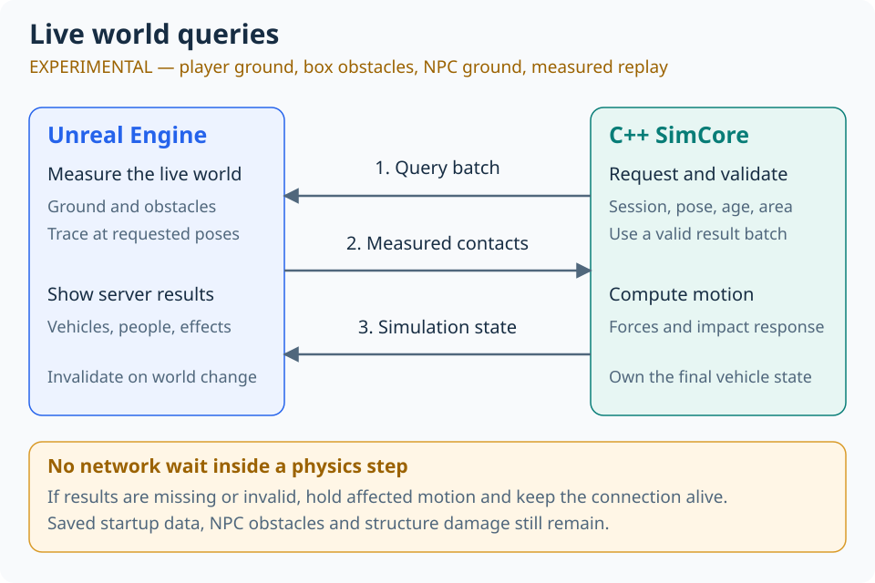
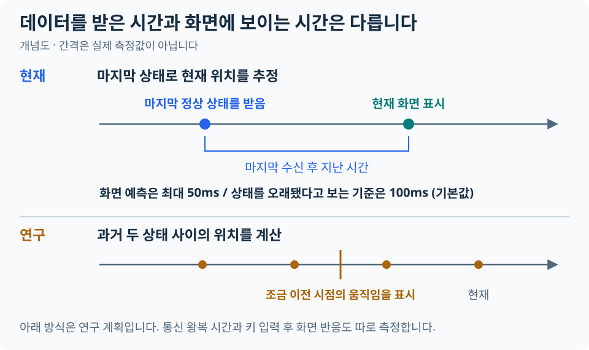
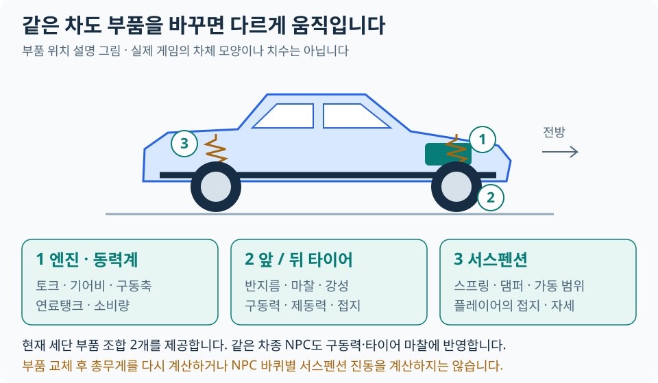
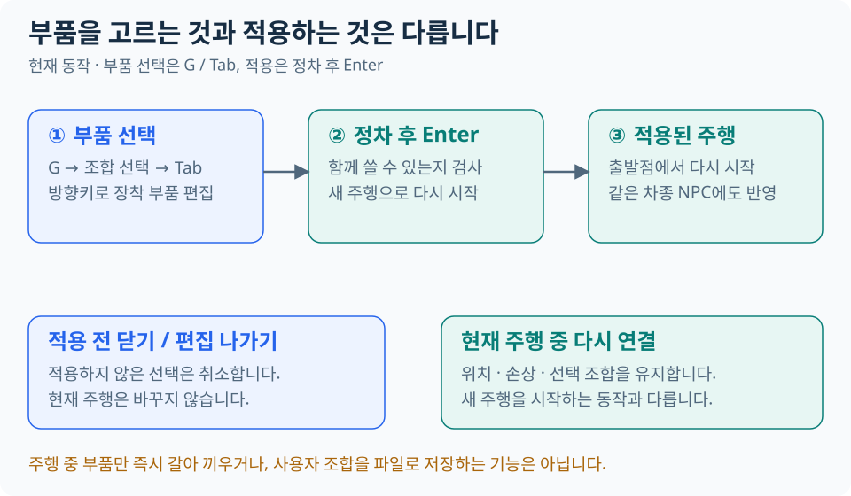
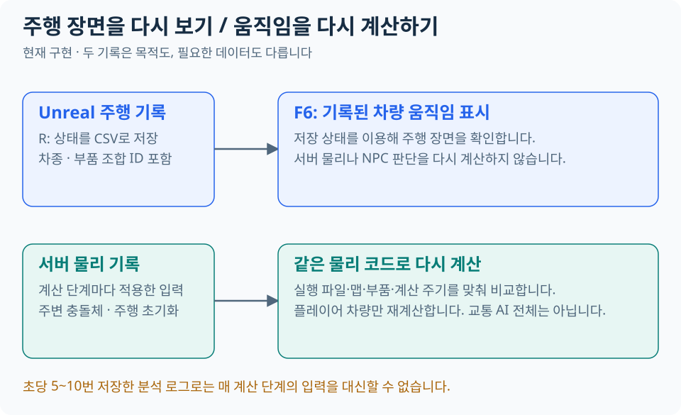
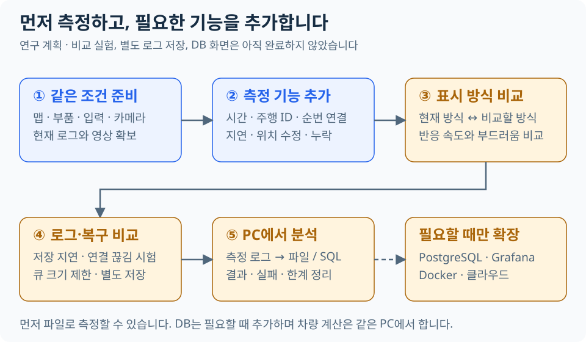

# 시스템 구조

Unreal Engine 5.6 클라이언트와 자체 C++ 서버를 연결한 로컬 운전 시뮬레이션입니다.
차량의 최종 상태는 서버가 결정합니다. Python은 개발 검증 도구이며 실행용 중계 서버는 없습니다.

처음 읽을 때는 아래 순서로 보시면 됩니다. 부품의 필드·계산식은 각 절의 상세 설명입니다.

1. [전체 책임과 흐름](#책임과-데이터-흐름) → [상태 수신과 화면 표시](#연결과-시간)
2. [실행용 차량 구성](#기존-네-차종-설정-이관--2단계) → [부품을 고르고 적용하는 과정](#부품-조합-선택-화면npc-적용--5단계)
3. [기록·재생](#기록재생과-검사) → [현재 관측과 후속 연구](#관측과-연구-확장)
4. [실시간 월드 측정 전환 계획](#실시간-월드-측정-전환-계획) — 아래 현재 구현과 구분한 후속 작업입니다.

## 책임과 데이터 흐름


| 담당 | 책임 |
|---|---|
| C++ 서버 | 차량 움직임·충돌·NPC 행동·신호를 계산하고, 어느 연결에서 조작할 수 있는지 관리 |
| Unreal | 입력 받기, 맵 데이터 내보내기, 화면·카메라·소리 표시 |
| 서버용 맵 데이터 (`MapPackage`) | 서버 계산에 필요한 지면·장애물·차선·신호 정보 |

차량 계산에는 외부 차량 물리 SDK를 사용하지 않습니다. Unreal의 팔다리 래그돌 등
표시용 물리는 별개이며 그 결과를 서버 차량 운동에 되먹이지 않습니다.

`--physics-hz`로 실행 주기를 바꿀 수 있습니다(허용 범위 1~1000Hz). 기본 운전·검증 기준은
60Hz이며, 설정이 허용된다는 것이 모든 주기에서 동일한 품질과 성능을 검증했다는 뜻은 아닙니다.
물리 시간은 단조 시계의 고정 간격으로 전진하고 렌더 FPS와 독립적입니다.

## 서버용 맵 데이터가 필요한 이유

`MapPackage`는 **이 프로젝트에서 정한 파일 묶음 이름**입니다. Unreal의 표준 기능이나
게임 설치 파일을 뜻하지 않습니다. 설명에서는 **서버용 맵 데이터(Server map data)**라고 부릅니다.

SimCore는 Unreal Engine을 실행하지 않는 별도 C++ 프로그램입니다. 현재 서버에는 `.umap`이나
Unreal 에셋에서 지면·충돌 정보를 읽는 기능이 없습니다. 하지만 자동차를 계산하려면 타이어 아래의
지면 높이와 벽의 위치를 알아야 합니다. 그래서 Unreal에서 필요한 정보를 측정해 파일로 저장합니다.

| 서버가 알아야 하는 것 | 현재 저장 파일 | 쓰는 곳 |
|---|---|---|
| 지면 높이·기울기·재질 | `ground_heightfield.bin` | 바퀴가 지면에 닿는 위치와 마찰 계산 |
| 벽·연석의 충돌 범위 | `static_colliders.csv` | 차량이 장애물에 부딪히는지 검사 |
| 차선 연결·신호 순서 | `traffic_network.json` | NPC 경로와 신호 계산 |
| 지면·충돌 파일 목록과 식별값 | `manifest.cfg` | 빠진 파일이나 서로 다른 데이터를 사용하는지 검사 |

이 파일에는 화면용 건물 메시·텍스처·조명이 들어 있지 않습니다. 교통 파일은 지면·충돌 파일과
별도로 검증하며, 두 데이터가 같은 맵을 가리키는지도 확인합니다.

**다른 게임에 맵 데이터가 없는 것은 아닙니다.** 예를 들어 Unreal 전용 서버는 Unreal의 서버용
맵과 콘텐츠를 준비해 실행합니다. 이때 데이터 처리를 엔진이 맡으므로 이 프로젝트와 같은 별도
내보내기 파일을 사용자가 볼 필요가 없습니다. [Epic의 전용 서버 설명](https://dev.epicgames.com/documentation/en-us/unreal-engine/setting-up-dedicated-servers-in-unreal-engine?application_version=5.6)을 참고하세요.

이 방식의 장점은 Unreal 화면을 켜지 않고도 같은 지면에서 서버 물리를 시험할 수 있다는 것입니다.
대신 맵을 바꾸면 내보낸 파일도 갱신해야 하고, 실제 화면과 데이터가 일치하는지 검사해야 합니다.
모든 게임에 필요한 구조는 아닙니다. **Unreal과 자체 물리 서버를 분리한 현재 설계 때문에 필요한 구조**입니다.
서버도 Unreal로 실행하는 설계에서는 이 별도 변환 단계를 줄일 수 있지만, 서버 구조 변경이 필요합니다.

파일 형식은 [맵 데이터 안내](../map_packages/README.md), 실제 읽기 처리는
[`load_runtime_map_package`](../cpp/host/src/terrain/map_package_runtime.cpp)에 있습니다.

## 실시간 월드 측정 전환 계획

2026-10-04에 정한 전환 방향입니다. **비교·플레이어 지면·월드 변경 감지·측정 재생과 선택형 장애물/NPC 지면 연결을 구현했습니다. 전체 전환 완료는 아닙니다.** Unreal이 실행 중인 월드에서
지면과 충돌 정보를 측정하고, 별도 C++ 서버가 그 결과로 차량과 교통을 계산하도록 바꿉니다.
목표는 지형·장애물을 바꿀 때 지면/충돌 파일을 다시 Bake하거나 서버를 재시작하지 않는 것입니다.
별도 서버, 자체 차량 물리 계산식, 차량 부품 JSON, WebSocket/Protobuf는 유지합니다.

`--ground-query-shadow`는 물리에 영향을 주지 않는 비교 모드입니다. 최신 클라이언트와 서버는
**실제 물리 계산이 사용한 위치·깊이·파일 조회 결과**를 수집하고 같은 선 검사를 Unreal에서 실행합니다.
첫 구현의 중심/모서리 5지점·8m 조회는 v1 클라이언트 호환 경로로만 남겼습니다.
관측만 추가하며 **힘·접지·충돌·제어권은 바꾸지 않습니다.** 전체 지면 입력의 대체와
주행/부하별 인수는 남아 있습니다. [실행 방법과 제한](guides/core_validation.md#실시간-지면-측정-비교)



### 실험용 플레이어 지면 연결

`--live-ground`는 `ground-patch.v3`를 협상한 클라이언트에서만 동작합니다. 기존 비교 모드와 별도로,
WorldState의 7번 필드에 요청을, Envelope의 16번 필드에 응답을 넣습니다. 기존 필드의 뜻은 유지합니다.

| 경계 | 현재 구현 |
|---|---|
| Unreal 측정 | 25×25개 수직선. 정지 시 0.5m 간격·12×12m, 속도에 따라 축별 간격 최대 2m·범위 최대 48×48m. 차체 위 8m에서 깊이 32m. 프레임당 최대 128회 검사 |
| 연석 경계 | 서로 다른 높이가 나타난 셀에서 측면을 두 번 추가 측정. 두 검사와 모서리 높이가 같은 경계를 가리킬 때만 전송. 최대 128개 경계, 얕은 경사 위의 0.5m 이하 단차까지 제한 |
| 서버 보관 | 진행 중 요청 1개, 요청 간격 최소 100ms. 완성된 최근 두 묶음만 보관. 각 요청 생성부터 350ms가 지나면 사용 금지. 응답 도착 시 수명을 새로 늘리지 않음 |
| 지역 조회 | 같은 평면은 보간하고, 확인된 연석은 양쪽 높이를 분리. 두 평면의 교선이 측정점 구분과 맞는 급경사 시작점은 각각의 평면 사용. 법선이 지지하는 최대 경사 60°이며 등판 성능 보장은 아님 |
| 물리 적용 | 초기화·바퀴·서스펜션·차체 지면 접촉에 사용. 계산 중 미확인 조회가 나오면 자세·속도·연료·서스펜션 이력 전체 복원, 지난 충격 재적용 금지 |
| 대기와 복구 | 상태 전송·제어권 감시는 유지. 화면에는 정지 속도와 대기 이유 전송. NPC 실시간 옵션에서는 유한 질량 충돌로 연결된 틱도 함께 복원. 새 자료로 다음 1틱부터 재개하며 밀린 시간을 몰아 계산하지 않음 |
| 기존 공급자 | 기본 실행은 기존 파일 사용. 장애물/NPC 옵션을 각각 켠 조회만 실시간으로 전환하며 해당 조회 도중 파일로 자동 대체하지 않음 |

[서버 공급자](../cpp/host/src/terrain/live_ground_patch.cpp) ·
[Unreal 분할 측정](../unreal/DriveIntegration/Source/DriveIntegration/SimCoreLiveGroundPatch.cpp) ·
[실행과 검사](guides/core_validation.md#실험용-플레이어-지면)

전진·후진·옆미끄러짐을 포함한 실제 속도 방향으로 측정 중심을 최대 8m 앞당깁니다.
새 묶음이 조회 범위를 포함하지 않을 때만 아직 만료되지 않은 직전 묶음을 사용합니다.
새 묶음이 측정 실패나 구멍을 보고했다면 예전 지면으로 덮어쓰지 않습니다.
재질만 다른 같은 평면은 조회가 가능하며 가장 가까운 표본의 재질을 사용합니다. 정확한 재질 경계 측정은 아닙니다.

**2단계의 제한된 실험 구현입니다.** 0.5~2m 격자 사이의 작은 구멍·형상을 완전히 검출하지 못하며,
여러 프레임에 걸친 측정은 한 시점의 월드 스냅샷이 아닙니다. 월드 변경 감지 시 진행 중 작업을 취소하지만, 겹친 도로/터널·움직이는 지형·비동기 형상 변경을 모두 지원하는 것은 아닙니다.
측면을 확인하지 못한 단차·곡선/복합 경계는 임의 경사로 연결하지 않고 보류합니다.
고속 대응은 측정 범위 보완이며 연속 충돌 검사나 고속 주행 인수 완료를 뜻하지 않습니다.
급한 방향/높이 변화로 범위를 벗어나거나 측정이 만료되면 계속 보류합니다. 정상 지면 없음은 미수신과 구별하지만, 기존 지면 경계 복구 로직이 남아 있어
자유 낙하 인수를 통과한 것은 아닙니다. 알 수 없는 넘어진 객체의 지지면은 밟을 수 있는 지면으로 쓰지 않고 일반 충돌로 유지합니다.

측정 모드 기록은 아래 v2 재생을 사용합니다. 남은 인수를 통과하기 전에는 기본 모드를 바꾸거나 기존 Bake 데이터를 삭제하지 않습니다.

### 월드 변경과 측정 재생

Unreal은 조회 가능한 WorldStatic 컴포넌트의 형상 식별값·배치·충돌 설정·재질·표면 태그를 비교합니다.
변경 시 `world_revision`을 올리고 진행 중 지면 측정을 취소합니다. 서버는 같은 버전의 요청/응답만 허용하며
이전 지면·장애물·NPC 타일을 폐기합니다. 감지 한도 초과나 준비되지 않은 물리 상태는 측정 불가로 알립니다.
같은 식별값 안에서 형상을 직접 고치는 기능은 `NotifyLiveWorldChanged`를 호출해야 합니다.
버전 알림은 제어 입력이 아니므로 ControlLease를 연장하지 않습니다.

물리 재생 v2는 실제 사용한 조회 순서와 Hit/NoHit/Unavailable, 초기화 여부, 보류/적용 여부,
월드 버전, 정적·동적 충돌 입력을 기록합니다. 재계산은 파일 지면 대신 기록된 결과만 사용하며 Unreal이 필요 없습니다.
범위는 플레이어 물리의 재현입니다. NPC 판단이나 네트워크 타이머를 다시 실행하는 기능은 아닙니다.
기존 파일 모드의 v1도 유지합니다. 최대 216,000프레임과 1GiB 제한 중 먼저 도달한 한도를 적용하며,
강제 종료·잘린 파일·불완전한 기록은 검증에서 거부합니다.

### 선택형 장애물과 NPC 지면

| 옵션 | 실시간 입력과 한계 |
|---|---|
| `--live-obstacles` | 실제 UBox 또는 검증 가능한 단일 상자 충돌 형상을 측정합니다. 서버가 그 형상으로 기존 충돌 반응을 계산합니다. 회전된 상자는 수직축 회전만 지원하며, 기울어진/복합/미지원 형상과 128개 초과는 전체 영역을 미확인 처리합니다. 이동 전후 차체 범위와 350ms 유효 시간을 검사합니다. |
| `--live-npc-ground` | NPC·보행자가 요구한 지역의 0.5m 간격 25×25 표본을 공유합니다. 8m 중심 구역별 타일을 최대 128개 보관하며 진행 중 요청1개·대기 수요4개로 제한합니다. 응답 제한350ms와 월드 버전 알림의 수명350ms를 별도로 검사합니다. |

NPC 타일은 같은 월드 버전의 알림이 계속 도착하는 동안만 재사용합니다. 연결·버전 변경이나 알림 만료 시 전부 폐기합니다.
경로 탐색보다 현재 몸체를 지지하는 조회를 우선합니다. 미측정은 실제 지면 없음과 구별하고, 위치·경로 진행·사고 상태를 복원합니다.
Unreal은 플레이어128회 + NPC128회로 프레임당 최대256회의 지면 검사를 나누어 수행합니다.
정적 장애물은 별도의 제한된 상자 수집입니다. 이 수치는 목표 프레임 성능을 보장하는 수치가 아닙니다.

장애물 전환은 **플레이어 주변 정적 상자** 범위입니다. NPC 정적 장애물 계획, 구조물 피해의 초기 데이터,
차로·신호 정의와 시작 시 맵 검사는 아직 기존 파일을 사용합니다. 따라서 MapPackage 제거 단계는 남아 있습니다.

### 역할과 범위

| 담당 | 전환 후 맡을 일 | 맡기지 않는 일 |
|---|---|---|
| Unreal | 서버가 지정한 위치·형상에서 지면과 장애물 측정, 접촉 위치·법선·재질·객체 식별값 전달 | 플레이어와 NPC 차량의 최종 운동 결정 |
| SimCore | 측정 요청 구성, 결과 검증, 엔진·타이어·서스펜션·충돌 반응·NPC 판단·신호 계산 | `.umap` 직접 읽기, 렌더링 |
| 표시 계층 | 서버 결과를 차량·보행자·구조물·소리로 표현 | 화면 보정이나 장식용 래그돌을 물리 정답으로 사용 |

Unreal의 선·형상 검사는 충돌 위치와 표면 정보를 얻는 기능입니다. 충돌 반응을 계산하는 것과는
다릅니다. 따라서 월드 조회에 엔진을 사용하되 외부 차량 물리 SDK를 도입하지 않습니다.
[Epic의 Trace 설명](https://dev.epicgames.com/documentation/en-us/unreal-engine/traces-in-unreal-engine---overview?application_version=5.6)을 참고합니다.

첫 적용은 **같은 PC에서 플레이어 차량 한 대의 지면 측정**입니다. 기존 차량 수치와 화면 표시 방식을
동시에 바꾸지 않습니다. 차체·NPC·보행자·구조물은 뒤 단계에서 확장하며, 첫 단계만 끝났다고 Bake 제거를 완료한 것으로 보지 않습니다.

### 현재 코드에서 바꿀 지점

| 현재 코드 | 확인한 경계와 변경 방향 |
|---|---|
| [GroundQuery](../cpp/host/src/terrain/ground_query.hpp), [VehiclePhysics](../cpp/host/src/physics/vehicle_physics.cpp) | 지면 조회 인터페이스는 있지만 중심·바퀴·연석 등 여러 위치에서 동기 조회합니다. 각 호출을 통신 요청으로 바꾸지 않고, 한 계산 단계에서 읽을 수 있는 측정 묶음을 준비합니다. 네 바퀴의 단일 높이만 보내는 설계로 제한하지 않습니다. |
| [SimCoreGroundSnapshot](../unreal/DriveIntegration/Source/DriveIntegration/SimCoreGroundSnapshot.h) | 현재는 에디터에서 월드를 측정해 파일을 만드는 경계입니다. 재질·좌표 변환은 재사용하되 실행 중 조회와 파일 저장을 분리합니다. |
| [CollisionWorld](../cpp/host/src/collision/collision_world.hpp) | 현재 정적 충돌체 저장·접촉 검사·반응 계산이 연결돼 있습니다. 외부 접촉 정보 입력과 자체 반응 계산을 분리해야 하므로 지면 조회 구현만 교체해서 끝나지 않습니다. |
| [vehicle.proto](../protocol/vehicle.proto), [WebSocket 송신](../cpp/host/src/websocket/ws_server.cpp) | 첫 비교 요청은 WorldState에 포함하고 응답은 새 메시지로 받습니다. 요청 하나를 응답/만료까지 재게시하므로 최신 상태 교체에도 요청이 사라지지 않습니다. 실제 물리용 대량/다종 조회 정책은 후속 범위입니다. |
| [SimulationHost](../cpp/host/src/simulation_host.cpp), [NPC 연결](../cpp/host/src/simulation_host_npc.cpp) | 맵 체크섬이 연결·교통·구조물 초기화에 쓰이고 NPC 경로 구성도 지면을 조회합니다. 시작 시 준비 과정과 실행 중 조회를 함께 바꿔야 합니다. |
| [물리 재생](../cpp/host/src/replay/physics_replay.cpp) | 입력뿐 아니라 각 단계에서 실제 사용한 외부 측정 결과·유효성 판단도 기록해야 Unreal 없이 재계산할 수 있습니다. |

### 통신과 시간 규칙

첫 비교용 `ground-query-shadow.v1`, 실제 조회 비교용 `ground-query-shadow.v2`, 실험 입력용 `ground-patch.v3`를 사용합니다.
실험 입력 v2의 `patch_step_enu`·`boundaries`에 v3의 `world_revision`을 추가했습니다. 구형 live 클라이언트는 거부하고 비교 모드 계약은 유지합니다.
월드 버전 알림은 Envelope17, 장애물 응답은18, NPC 타일 응답은19입니다. WorldState8은 장애물 요청, 9는 NPC 타일 요청입니다.
장애물은 `world-obstacles.v1`, NPC 타일은 `npc-ground.v1` 지원을 추가 협상합니다.
`GroundQueryBatch`의 추가 깊이 배열은 v2를 협상한 클라이언트에만 보내며 기존 v1 필드의 뜻은 바꾸지 않습니다.
다음 규칙은 최종 실시간 물리 연결을 위한 설계이며, 구체적인 필드는 이후 구현에서 확정합니다.
비교 모드가 아래 계약을 전부 충족한다는 뜻은 아닙니다.
새 기능 협상과 명시적인 파일/실시간 실행 모드를 추가합니다. 기존 Protobuf 필드 번호를 재사용하거나
맵 체크섬 필드에 다른 뜻의 값을 넣지 않으며, 지원하지 않는 조합은 연결 시 설명하고 거부합니다.

1. **요청 식별:** 연결/Play 세션, 월드 변경 번호, 요청 번호, 기준 서버 tick, 객체 ID와 기준 자세를 함께 보냅니다.
   좌표는 기존 ENU 미터 계약을 사용하고 Unreal 센티미터·좌우손 변환을 경계에서 검사합니다.
2. **측정 묶음:** 요청에는 바퀴/차체 조회 형상·진행 구간·제외 객체를, 응답에는 접촉점·법선·거리·재질·객체 ID를 담습니다.
   `미수신`, `측정 실패`, `정상 측정했으나 접촉 없음`은 구분합니다. 큰 묶음의 일부만 도착하면 완성된 결과로 취급하지 않습니다.
3. **비동기 처리:** Unreal의 지원되는 월드 조회 경로에서 측정하고 네트워크 스레드가 `UWorld`를 임의 접근하지 않게 합니다.
   서버 계산 함수 안에서는 응답을 기다리지 않습니다. 검증한 불변 결과를 계산 단계 경계에서 교체합니다.
4. **유효 범위:** 결과의 나이뿐 아니라 측정 위치·차체 자세·공간 범위·월드 변경 여부를 확인합니다.
   평지의 한 접촉점을 다른 위치나 연석 너머에서 계속 재사용하지 않습니다. 조회 간격·거리·캐시 한도는 1~2단계 측정으로 정합니다.
5. **초기화와 중단:** 첫 유효 결과 전에는 출발하지 않습니다. 결과가 만료되면 해당 물리 진행을 보류하고 이유를 표시하며,
   임의의 평지나 오래된 접지를 만들어 계산하지 않습니다. 통신·heartbeat·제어권 감시는 계속하고, 복구 시 밀린 시간을 한 번에 계산하지 않습니다.
   잠깐의 자료 지연만으로 객체를 삭제하거나 Play를 초기화하지 않습니다.
6. **적체와 재접속:** 상태·측정·초기화 메시지별 큐/최대 크기/진행 중 요청 수를 제한합니다. 폐기·교체·시간 초과를 계측하고,
   입력·초기화가 측정 묶음 때문에 밀리지 않게 합니다. 재접속 후에는 기존 Play 상태를 보존하되 이전 연결의 측정 캐시는 버리고 새 결과를 받습니다.
7. **시계 구분:** 클라이언트 측정 시간, 서버 요청 후 경과 시간, 서버 수신 후 경과 시간, 사용한 기준 tick을 따로 남깁니다.
   서로 다른 프로세스의 단조 시계 값을 직접 빼지 않습니다. 화면 예측 한도·Health·제어권 제한을 늘려 문제를 숨기지 않습니다.

고속 주행에서는 이전 위치의 결과만으로 현재 충돌을 확정할 수 없습니다. 진행 경로를 포함한 형상 검사와
측정 범위를 함께 검증합니다. 그 범위를 벗어나면 계속 달리게 하기보다 자료 부족 상태를 명시합니다.
이 구조가 현재보다 빠르다는 가정은 하지 않습니다. 특히 서버 60Hz와 Unreal 프레임 속도가 달라도 안전하게 동작하는지 확인합니다.

### 단계별 작업과 완료 기준

현재 계산기의 조회 지점을 조사한 결과입니다. [관찰 경계](../cpp/host/src/terrain/ground_query_capture.hpp)는
`VehiclePhysics::update` 안의 모든 `GroundQuery` 호출을 원래 공급자에 전달하면서 결과를 수집합니다.
같은 위치·깊이의 중복만 묶으며 반환값은 수정하지 않습니다. 초기화 중 조회와 NPC 자체 조회는 이 수집 범위 밖입니다.

| 소비 지점 | 필요한 정보 | 실시간 연결 시 주의점 |
|---|---|---|
| 초기 자세/높이 정렬 | 중심·바퀴 아래 최대 24m | 초기화도 첫 측정 묶음을 기다리는 별도 경로가 필요 |
| 바퀴·서스펜션 반복 계산 | 기울어진 실제 장착 위치, 최대 24m | 이동·자세 보정 후 다시 조회하므로 처음의 네 높이만 재사용하면 안 됨 |
| 연석 통과 판단 | 연석 진입/이탈 주변 지면, 최대 24m | 접지 결과와 차체 충돌 필터가 같은 지면 근거를 써야 함 |
| 차체 지면 접촉 | 차체 외곽 14개 표본과 반복 보정, 최대 24m | 차체 바닥뿐 아니라 전복 자세의 외곽까지 조회 |
| 넘어진 객체를 밟는 조건 | 객체 아래 3지점, 4m | 해당 객체가 실제 지면에 놓여 있는지 확인 |
| 맵 범위 이탈 검사 | 중심과 바퀴의 접촉 유무 | 현재는 지면 없음에 이동을 취소할 수 있음. 실시간 모드의 정상 공중 상태와 자료 미도착을 먼저 분리해야 함 |

따라서 2단계는 공급자 포인터만 교체하는 작업이 아닙니다. 유효한 공간 범위와 초기화 대기,
접촉 없음/미측정 구분, 실제 사용한 결과의 재생 기록을 연결해야 합니다. 아래 단계의 완료 기준은 유지합니다.

| 순서 | 작업 | 다음 단계로 넘어갈 기준 |
|---|---|---|
| 0 | 기준 주행 저장, 전체 지면/충돌 소비 지점 목록, 측정 계약과 객체 소유권 정리 | 같은 revision·맵·차종·입력의 기준 로그 확보. 좌표·누락 상태·큐 한도·회귀 지표와 복귀 방법을 구현 전에 명시 |
| 1 | 측정만 전송하는 비교 모드 | 기존 파일 기반 물리는 그대로 실행. Unreal 실시간 결과와 기존 지면의 차이, 조회/송수신 비용·결과 나이·큐 최대 길이를 확인. 평지·경사·연석·지면 없음·새 Play 검사 통과 |
| 2 | 플레이어 지면 계산에 연결 | 서버가 실시간 측정 묶음으로 접지·서스펜션 계산. 지형 변경 후 재Bake/서버 재시작 없이 반영. 한쪽 바퀴 연석·경사 정지/재출발·공중·재접속 검사, 재생 기록/재계산 통과 |
| 3 | 차체와 정적 구조물 충돌 연결 | 이동 경로 형상 검사와 자체 반응 계산 분리. 벽·연석·기둥·초기 겹침·측면/지붕 접촉·고속 충돌에서 관통과 중복 충격 검사. 필요 시 반응 계산의 부족한 축을 이 단계에서 보완 |
| 4 | NPC·보행자·움직이는 구조물로 확장 | 기본 NPC 10대/보행자 8명에서 지면·장애물 조회 반영. 사고 우회·후진·중앙선 비침범·넘어진 객체 확인. 객체 삭제/재생성·파손 시 오래된 측정 거부, 동일 충돌을 한 번만 반영 |
| 5 | 통합 인수와 실행 경로 정리 | 지연/누락/프레임 저하·30분 주행·기록 재생·새 Windows 패키지 확인. 실시간 모드를 기본으로 전환한 뒤 불필요한 지면/충돌 Bake 의존성과 사용 안내 제거 |

각 단계는 별도 변경 단위로 진행합니다. 평지의 실제 조회 비교를 확인한 뒤 2단계 실험을 추가했지만, 1단계의 연석·고속·부하 전체 인수와 2단계 완료 기준을 충족했다고 처리하지 않습니다.
2단계에서는 지면만, 3단계에서는 정적 충돌까지 전환됐음을 명시하고 각 데이터의 공급자를 실행 시작 시 고정합니다.
전환 중 문제가 생겨도 실행 도중 몰래 파일 데이터로 바꾸지 않습니다. 비교 모드에서 기존 경로로 되돌려 재현합니다.
완료 날짜는 아직 정하지 않습니다. **1단계에서 실제 측정 비용과 지연을 확인한 뒤 남은 작업량을 산정**합니다.

### 동적 객체와 교통 데이터

플레이어·NPC·보행자·파손 구조물의 게임플레이 위치·속도는 서버가 소유합니다. Unreal에서 동적 접촉을
측정할 때도 요청의 서버 자세에 맞춘 조회용 형상을 사용해야 합니다. 부드럽게 보정된 화면 위치나
장식용 래그돌 위치를 그대로 쓰면 한 물체가 서로 다른 위치에 존재하게 됩니다. 자체 차량 반응과
Unreal 강체 반응을 같은 객체에 중복 적용하지 않습니다. 표시용 래그돌을 권위 있는 물리로 바꾸는 일은 이번 범위가 아닙니다.

차선 연결·중앙선 규칙·신호 주기·파손 가능한 구조물 ID는 레이 검사로 만들어지지 않습니다.
교통 데이터는 우선 유지하되 지면/충돌 파일 체크섬과의 강한 결합을 분리하고 월드 식별값·버전으로 맞춥니다.
NPC의 경로 초기화에 필요한 지면 조회는 시작 시 묶어서 준비하며, 플레이어 주변 정보만으로 전체 NPC를 계산하지 않습니다.
교통 데이터까지 실행 중 자동 전달하는 기능은 별도 후속 작업입니다. `map_packages/` 전체 삭제는 이번 계획의 완료 조건이 아닙니다.

### 검증과 기록

- **자동 검사:** 계약·좌표·잘못된 수치·세션/월드 변경·중복/역순/부분 결과·큐 한도·누락 복구를 검사합니다.
  접촉 없음과 자료 미도착을 구분하고 지면/차체 공급자를 혼용하지 않는지도 확인합니다.
- **비교 실험:** 같은 입력과 맵으로 기존 모드와 실시간 모드를 비교합니다. 입력 반응, query/서버 step의 p95·최대 시간,
  측정 결과 사용 나이, 무효 결과 수, 상태 수신 간격, 최대 큐 길이, 관통/접지 오차를 기록합니다.
  수치 허용치는 0~1단계 기준 측정 후 고정하고 결과를 보고 느슨하게 바꾸지 않습니다.
- **고장 주입:** 시험 조건으로 0/20/50/100ms 추가 지연, 결과 누락·묶음 도착·재접속, Unreal 30/60/120FPS를 비교합니다.
  이는 모두에서 동일한 주행 품질을 보장한다는 뜻이 아닙니다. 정상 주행 범위와 안전하게 보류되는 범위를 보고합니다.
- **재생:** 실제 적용한 측정 묶음·캐시 선택·무효 판정·적용 tick·모드·설정 버전을 기록합니다.
  기록에서 측정 공급자를 재구성해 서버 물리 재생을 검증합니다. 필수 결과 누락은 불완전한 기록으로 표시하며,
  Unreal CSV 시각 재생과 구분합니다. 기존 파일 모드 재생·시험 자료는 참조가 남아 있는 동안 보존합니다.
- **수동 인수:** 네 차종·부품 교체·연석 재출발·전복·사고 우회·지형/장애물 변경을 실제 화면에서 확인합니다.
  기본 교통 수의 30분 주행과 패키지 실행이 끝나기 전에는 완료로 표시하지 않습니다.

이 전환은 로컬 시뮬레이터를 위한 설계입니다. 서버가 최종 상태를 계산하더라도 클라이언트가 측정값을
제공하므로 부정행위에 강한 온라인 서버 구조가 되는 것은 아닙니다. 또한 실시간 모드는 Unreal이 없으면
새 월드를 측정할 수 없습니다. 독립 서버 시험은 기록된 측정 또는 테스트 전용 공급자를 사용합니다.
보간·DB·클라우드 연구와 새 차량/AI 확장은 함께 변경하지 않습니다.

## 연결과 시간



그림의 간격은 개념 표현입니다. 50ms는 예측의 기본 한도이고 100ms는 Health 신선도의 기본값이며,
둘 다 실제로 측정한 네트워크 왕복 지연이 아닙니다.

연결을 시작할 때 `Hello` 메시지로 통신 형식·맵·필요한 기능이 맞는지 확인합니다.
새 Play에서는 새 주행을 시작합니다. 서버는 입력이 현재 주행의 명령인지, 순서와 시간이 맞는지 확인한 뒤 적용합니다.
Unreal은 서버 계산과 별도로 화면을 그립니다. 새 상태가 아직 오지 않았을 때는 짧은 시간만 움직임을 예측합니다.
현재 `BuildVehicleSample`은 **최신 상태 하나를 기준으로 기본 최대 50ms까지 예측**합니다.
플레이어와 NPC 모두 과거 상태 여러 개를 쌓아 지연 보간하는 구조는 아닙니다.

같은 Play에서 다시 연결되면 위치·사고 상태를 유지합니다. 새 Play나 차종 변경은 출발점에서 다시 시작합니다.
잠시 상태를 받지 못했다고 차량을 지우거나 게임을 처음부터 시작하지 않습니다.
현재는 같은 PC의 서버에만 연결할 수 있습니다(loopback).

| 기준 | 목적 |
|---|---|
| 마지막 상태를 받은 뒤 지난 시간 | 상태를 계속 사용할 수 있는지 판단. Health 기본 기준은 100ms |
| 화면 움직임을 예측하는 시간 | 받은 상태에서 앞으로 예측할 수 있는 최대 시간. 기본 50ms |
| 연결 타임아웃 | 통신이 끊기면 재접속 |
| 서버 제어권·입력 만료 | 이전 명령으로 계속 가속하지 않도록 안전 정지·제어권 회수 |

이 시간을 늘려 지연을 숨기지 않습니다. 입력 대기 시간·수신 간격과
[실제 키 입력→화면 반응](guides/input_latency_measurement.md)은 다른 지표입니다.
서버 처리가 늦어도 물리 시간 간격을 크게 늘리지 않으며 초과 횟수를 진단에 남깁니다.
`server_age`는 서버 UTC 타임스탬프와 클라이언트 UTC의 차이이고 `local_age`는 로컬 수신 후
경과 시간입니다. 둘 다 요청을 보내고 응답이 돌아오는 RTT가 아닙니다. 시계 보정의 영향도 다릅니다.
표시 버퍼를 연구하더라도 최신 수신 상태의 Health·제어권 판단을 지연된 화면 상태로 대체하지 않습니다.

## 좌표와 지도

| 경계 | 규약 |
|---|---|
| 서버 지도 ENU | X 동쪽, Y 북쪽, Z 위쪽; 미터 |
| 공통 차체 FLU | X 전방, Y 왼쪽, Z 위쪽 |
| Unreal 차체 | X 전방, Y 오른쪽, Z 위쪽; 센티미터 |

자세·각속도는 좌표계의 좌우손 차이까지 변환합니다. 위치 벡터의 부호 변환을 무조건
재사용하면 안 됩니다. 항법 heading(북쪽0도·시계 방향)과 왼쪽 양수인 공통 yaw도 구분합니다.

Unreal이 지면 높이·법선·유효 영역·재질을 측정해 내보내고 서버가 접지·힘을 계산합니다.
매 틱 Unreal에 레이 결과를 요청하는 구조가 아닙니다. Bake 교체는 파일·checksum·traffic
연결을 검증한 뒤 틱 경계에서 반영하며, 불완전한 자료를 부분 적용하지 않습니다.

기본 맵은 `L_SignalCity`, 서버용 맵 데이터 폴더는 `map_packages/signal_city_v2`입니다.
도로·표시·NPC 경로는 같은 저작 곡선을 사용합니다. [생성 순서](guides/signal_city_quickstart.md)를
따르며, 일반 Play를 위해 Bake나 지도 재생성을 반복할 필요는 없습니다.

## 차량·충돌·교통

플레이어는 바퀴별 접지·타이어 힘·1차원 스프링/댐퍼를 결합한 축약 모델입니다.
구동·제동·조향과 차체 높이·pitch·roll을 계산하며 차종별 설정을 구분합니다.
특정 실차를 시험 데이터로 동정한 모델은 아닙니다. 오토바이의 기울기·균형 보정도
완전한 이륜차 동역학을 의미하지 않습니다.

조향 입력은 기구의 목표이고 실제 회전 반경은 속도·타이어 힘·하중·접지에 따라 달라집니다.
차체 접촉·손상은 서버가 결정합니다. Unreal의 메시 찌그러짐이 서버 충돌 외곽까지
변형하는 것은 아닙니다. [충돌 범위](reference/collisions.md)를 참고합니다.

NPC는 도로 연결망·신호·장애물·차체 크기로 목적지와 우회를 판단합니다.
필요하면 후방을 확인해 짧게 후진하지만 중앙선 침범·순간 이동은 허용하지 않습니다.
운전자 영상을 인식하는 AI가 아니며 NPC마다 플레이어와 같은 타이어 모델을 실행하지 않습니다.
보행자는 지정 경로와 보행 신호를 따릅니다.
[NPC 판단](reference/npc_navigation.md), [도로·신호 계약](reference/traffic_network_signals.md)에 상세 기준이 있습니다.

## 차량 부품 데이터 — 1단계

차체와 부품을 따로 정의하고 장착 조합에서 ID로 연결하는 기반을 추가했습니다.
**이 절의 1단계 부품 조립 예제는 아직 주행에 직접 연결하지 않은 작성·검증 도구입니다.**
실제 네 차종 설정은 아래 [2단계 실행용 카탈로그](#기존-네-차종-설정-이관--2단계)를 사용합니다.
부품 조립식과 기존 축약 계산식의 차이를 숨기지 않고, 먼저 기존 주행값을 보존한 뒤 단계적으로 연결합니다.

| 어디를 수정하나요? | 역할·예제 |
|---|---|
| [catalog.json](../cpp/host/config/vehicles/catalog.json) | 읽을 파일의 명시적 목록. 폴더에 파일만 넣으면 자동 등록되지는 않습니다. |
| [chassis/sedan_reference.json](../cpp/host/config/vehicles/chassis/sedan_reference.json) | 차체 자체 질량·관성, 외형 치수, 축 위치·폭, 부품 장착 위치와 허용 규격 |
| [parts/](../cpp/host/config/vehicles/parts) | 여러 차량이 공유하는 엔진·변속기·구동계·휠·타이어·서스펜션·브레이크·조향장치·연료통 |
| [assemblies/sedan_standard.json](../cpp/host/config/vehicles/assemblies/sedan_standard.json) | 어떤 차체에 어떤 부품을 장착할지 지정하는 기본형 조합 |
| [assemblies/sedan_comfort.json](../cpp/host/config/vehicles/assemblies/sedan_comfort.json) | 같은 차체·엔진에 타이어와 서스펜션만 교체한 비교 조합 |

각 파일에는 `schema_version`, 고유 `id`, 표시용 `name`이 있습니다. 부품 ID를 바꾸면 이를
참조하는 조합도 함께 수정합니다. 카테고리는 sedan/suv/compact/truck/bus/motorcycle을 구분하지만,
현재 예제 차체는 세단 하나입니다. SUV·버스 모델이나 새 주행 기능을 추가한 것은 아닙니다.
`dynamics_model`은 카테고리와 별개로 `four_wheel` 또는 `single_track`입니다. 다축 차량은 아직 지원하지 않습니다.

### 부품에 저장하는 값

모든 부품에 질량·부품 자체 무게중심·자체 관성을 적습니다. 장착 호환성은 `interface_id`로,
타이어와 휠의 결합은 림 지름·허용 폭으로 검사합니다. 이름이 비슷하다고 자동 호환되지는 않습니다.

| 부품 | 주요 설정 |
|---|---|
| 엔진 | RPM별 토크 곡선, 공회전/최대 RPM, 회전 관성, 반응 시간, 연료 종류, 공회전 소비량, BSFC |
| 변속기·구동계 | 전진 기어비 목록, 후진·종감속비, 변속기 허용 입력 토크, 효율, 앞축 토크 비율 |
| 휠·타이어 | 림 지름·폭·회전 관성, 타이어 반지름·폭, 마찰계수, 종/횡 강성, 구름저항, 허용 하중 |
| 서스펜션 | 기준 길이, 압축/신장 범위, 스프링·댐퍼 계수, 최대 지지력 |
| 브레이크·조향 | 바퀴당 제동·주차제동 토크, 최대 조향각, 조향/복귀 속도 |
| 연료통 | 빈 통의 질량, 용량, 연료 종류·밀도 |

BSFC(`g/kWh`)는 엔진이 같은 에너지를 만들 때 필요한 연료 질량을 나타내는 값입니다.
토크 곡선으로부터 출력 `P = T × RPM × 2π / 60`을 계산하므로 최대 출력 숫자를 따로 중복 저장하지 않습니다.
1단계의 전체 조립 예제는 주행에 자동 적용되지 않습니다. 같은 부품 형식을 실행용 카탈로그에 등록하고
선택하는 방법은 아래 3·4단계에 설명합니다. 토크 곡선·기어·연료의 주행 계산은 4단계에서 연결했습니다.
엔진이 바퀴에 전달하는 힘과 타이어가 지면에서 버틸 수 있는 힘도 서로 다른 단계입니다.

### 조립 계산과 검증 범위

1. 목록의 파일을 모두 읽고 버전·필수 항목·자료형·범위를 검사합니다.
2. 장착 ID와 부품 종류·인터페이스를 대조합니다. 휠/타이어 규격, 차체가 허용하는 타이어 크기,
   엔진 토크와 변속기 허용치, 연료 종류도 검사합니다.
3. 부품을 장착 위치로 옮겨 건조 질량·무게중심·3×3 관성 텐서를 계산합니다.
4. 무게중심이 바퀴 지지 영역 안에 있는지, 좌우 치우침을 포함한 평지의 정적 하중 분배가
   타이어 허용 하중·서스펜션 최대 지지력·예압 없는 스프링의 최대 압축 지지력을 넘지 않는지 검사합니다.
5. 모든 조합이 유효할 때만 완성된 카탈로그를 반환합니다. 하나라도 잘못되면 파일/항목 또는 조합/부품을 표시하고 실패합니다.

차체 질량에는 교체 부품을 포함하지 않습니다. 엔진 등은 한 개씩, 바퀴 부품은 사륜차에서 축당 두 개,
이륜차에서 축당 한 개를 더합니다. 연료·운전자·적재물은 건조 질량에 포함하지 않아 중복 합산을 막습니다.
기본 예제는 건조 질량 **1,470kg**이며 현재 게임의 1,500kg 세단을 그대로 옮긴 자료가 아닙니다.

좌표는 미터·FLU입니다. 부품 자체 관성은 자체 무게중심 기준의 대각 성분이며 차체 축과 평행하게
장착합니다. 조립 관성에는 평행축 정리의 비대각 성분도 포함합니다. 축 부품의 장착 기준점은
명목 바퀴 중심이며 부품의 `center_of_mass_m`으로 그 기준점에 대한 질량 위치를 지정합니다.
실제 링크 기구·회전된 부품 장착·최대 적재/코너링 하중·메시 간섭 전체를 검증하는 도구는 아닙니다.

숫자를 문자열로 쓰거나 항목을 오타로 추가하는 경우, 중복 ID/JSON 키, 잘못된 관성·토크 곡선도
거부합니다. 목록은 카탈로그 폴더 내부 JSON만 참조할 수 있습니다. 파일당1MiB, 중첩32단계,
정의 파일256개·목록 포함 총16MiB로 제한합니다. 목록 자체의 공백·순서는 checksum에서 제외하고,
스키마 버전과 분류별 정의 파일 경로·내용을 정렬해 계산합니다. 부품 내용이 바뀌면 checksum도
달라집니다. FNV-1a는 변경 감지용이고 보안 서명은 아닙니다.
실행 상태와 분리된 정의이므로 현재 연료량·RPM·손상값은 이 파일에 저장하지 않습니다.

### 직접 확인하기

프로젝트 루트의 PowerShell에서 실행합니다. 서버와 Unreal을 실행할 필요가 없습니다.

```powershell
cmake --preset release -S .\cpp\host
cmake --build .\cpp\host\build --config Release --target simcore_vehicle_catalog vehicle_catalog_tests vehicle_catalog_json_tests
.\cpp\host\build\Release\simcore_vehicle_catalog.exe .\cpp\host\config\vehicles\catalog.json
ctest --test-dir .\cpp\host\build -C Release -R vehicle_catalog --output-on-failure
```

조합 하나만 보려면 검사 실행 명령 끝에 `sedan_comfort`를 붙입니다. 부품을 바꾸려면 기존
파일 전체를 복제하기보다 새 부품 파일과 ID를 등록하고 조합의 참조만 바꿉니다.
이 부품 예제에는 실시간 교체·차고 UI·실제 부품 동역학 연결이 없습니다.
실행용 카탈로그가 연결되었더라도 이 예제의 검사 결과가 곧 주행 설정인 것은 아닙니다.

## 기존 네 차종 설정 이관 — 2단계



기존 세단·경차·트럭·오토바이의 값을 공유 JSON으로 옮겼습니다. 서버와 Unreal이 **같은 파일**을
읽으며, 차종을 바꿀 때 파일을 다시 읽지 않고 시작할 때 검증한 설정을 사용합니다. 물리 법칙이나
NPC 경로 판단을 새로 바꾼 작업은 아닙니다. 외부 물리 SDK도 사용하지 않습니다.

### 실제 설정 위치

공유 파일은 [Unreal/Config/VehicleCatalog](../unreal/DriveIntegration/Config/VehicleCatalog)에 있습니다.
Unreal 설정 폴더에 두지만 서버도 같은 자료를 읽습니다. 서버용·클라이언트용 복사본을 따로 편집하지 않습니다.

| 파일 | 내용 |
|---|---|
| [catalog.json](../unreal/DriveIntegration/Config/VehicleCatalog/catalog.json) | 읽을 네 차종 파일 목록 |
| [sedan.json](../unreal/DriveIntegration/Config/VehicleCatalog/profiles/sedan.json) | 세단의 ID·NPC·시각 설정. 물리는 아래 공통 기준값을 그대로 상속 |
| [compact.json](../unreal/DriveIntegration/Config/VehicleCatalog/profiles/compact.json) | 경차의 물리 차이값·NPC·시각 설정 |
| [truck.json](../unreal/DriveIntegration/Config/VehicleCatalog/profiles/truck.json) | 트럭의 물리 차이값·NPC·시각 설정 |
| [motorcycle.json](../unreal/DriveIntegration/Config/VehicleCatalog/profiles/motorcycle.json) | 이륜차의 물리 차이값·NPC·시각 설정 |
| [vehicle_sedan.cfg](../cpp/host/config/vehicle_sedan.cfg) | 현재 축약 계산기의 공통 기준값. 기존 사용자 설정과 상속 동작을 유지 |

프로필의 `player_overrides`는 기준값에서 바뀌는 물리 항목입니다. 빠진 항목은 기준값을 사용합니다.
`scale_suspension_by_mass`는 기존처럼 질량비로 스프링·댐퍼·최대 지지력을 조정합니다.
오토바이는 `rest_length_cg_tire_offset_m`으로 기존의 `CG 높이 - 타이어 반지름 + 보정값` 순서를 유지합니다.
서스펜션의 직접 차이값 이름은 `suspension_max_compression_m`처럼 밑줄을 사용하며,
기준 cfg의 `suspension.max_compression_m`과 표기 방식이 다릅니다.

`npc`는 경로 주행·충돌에 쓰는 크기, 질량, 관성, 속도 배율, 가감속, 최소 회전 반경입니다.
NPC를 플레이어의 바퀴별 동역학으로 바꾼 것은 아닙니다. 5단계에서는 선택한 부품으로 축약 가감속을 계산합니다.
`visual`에는 바퀴/램프/배기 위치, 바퀴 크기, 운전자 변환, 차체 높이와 충돌 위치 보정을 둡니다.
물리는 SI 단위, `*_cm` 시각 위치는 Unreal의 센티미터·X 전방/Y 오른쪽/Z 위쪽입니다.

| 차종 ID | 질량 kg | 축간 거리 m | 타이어 반지름 m | 구동력 상한 N | 출력 상한 kW |
|---|---:|---:|---:|---:|---:|
| sedan_standard | 1500 | 2.700 | 0.320 | 6000 | 100 |
| compact_standard | 1050 | 2.133 | 0.275 | 5200 | 80 |
| truck_standard | 6200 | 3.850 | 0.390 | 18000 | 180 |
| motorcycle_standard | 240 | 1.810 | 0.336 | 1800 | 55 |

위 표는 현재 기본 설정입니다. 수정 후 실제 합성값은 다음 명령으로 확인합니다.

```powershell
.\cpp\host\build\Release\simcore_vehicle_catalog.exe --runtime .\unreal\DriveIntegration\Config\VehicleCatalog\catalog.json .\cpp\host\config\vehicle_sedan.cfg
```

트럭의 플레이어 충돌 지상고0.49m와 NPC0.411071m는 서로 다른 기준점에 맞춘 기존 값이라 유지합니다.
모델의 바퀴 장착 위치와 물리 접점이 모두 같은 좌표라는 가정으로 덮어쓰지 않습니다.
차체 메시 선택·카메라/운전자 동작처럼 여전히 코드와 에셋이 필요한 표현도 있습니다.

### 선택·연결·재생·배포

- **시작:** 서버가 공통 cfg와 네 프로필을 검증합니다. 설정 오류가 있으면 기본값으로 숨기지 않고 시작에 실패합니다.
- **선택:** 1~4 입력의 기존 차종 번호를 보내면 서버가 대응 ID의 설정을 기존 물리 객체에 적용하고 새 Play 세션을 초기화합니다.
  기존처럼 NPC·보행자·사고 상태도 새 Play 경계에서 초기화합니다. 플레이어 Pawn을 새로 스폰하는 방식은 아닙니다.
- **재연결:** 같은 Play 세션에서는 현재 위치·선택·사고 상태를 유지합니다. 매 틱 파일을 읽거나 설정을 재적용하지 않습니다.
- **설정 불일치:** Hello에 카탈로그 체크섬을 넣어 서로 다르면 연결을 거부합니다. 수정 뒤에는 서버와 Unreal을 모두 재시작합니다.
  체크섬은 manifest와 네 파일의 실제 바이트를 포함하므로 공백 수정도 변경으로 취급합니다. Git 줄바꿈 자동 변환은 제외합니다.
- **서버 물리 재생:** 실행 파일·기준 cfg·전체 런타임 카탈로그·지도·초기 자세를 확인하고 기록 당시 설정과 다르면 거부합니다.
- **Unreal 시각 재생:** 새 기록에는 카탈로그 체크섬을 남깁니다. 다른 설정으로 만든 기록은 재생하지 않습니다.
  체크섬이 없던 이전 기록은 읽을 수 있지만 당시 차량 설정이 같은지까지 보장하지는 못합니다.
- **배포:** manifest·프로필·목록에 등록한 부품 JSON을 일반 파일로 포함하고 원본과 SHA-256을 비교합니다. 배포 서버도
  `Windows/DriveIntegration/Config/VehicleCatalog/catalog.json`을 읽어 클라이언트와 한 복사본을 공유합니다.

서버 실행 cfg의 `vehicle_catalog`는 cfg 위치 기준 상대 경로이며 `--vehicle-catalog`로 지정하면 이를 우선합니다.
1단계 예제와 실행용 파일은 서로 다른 스키마이므로 바꿔 넣지 않습니다. 현재 통신·표시에는 기존 네 차종만
연결했으므로 SUV·버스 추가는 JSON만으로 완료할 수 없습니다. 지원 부품의 파일 기반 교체는 아래 단계를 따릅니다.
축별 타이어·서스펜션 연결은 아래 3단계, 엔진·변속기·연료 계산은 4단계에서 다룹니다.

## 타이어·서스펜션 교체 — 3단계

앞·뒤 축에 서로 다른 부품을 지정할 수 있습니다. 한 축의 좌·우 바퀴에는 같은 부품을 사용합니다.
서버가 시작할 때 부품을 검증하고 차종 선택/초기화 시 실제 접지·타이어 힘·스프링·댐퍼 계산에 적용합니다.
파일에서 직접 지정하거나 아래 5단계의 조합 선택 화면을 사용할 수 있습니다.
**기본 프로필은 모두 `null`로 두어 기존 주행과 사용자 기준 cfg를 유지합니다.**

### 어디를 수정하나요?

실행용 부품은 [VehicleCatalog/parts](../unreal/DriveIntegration/Config/VehicleCatalog/parts)에 있습니다.
파일 형식은 1단계의 `PartDefinition`을 재사용하지만, 실행용 예제의 값은 현재 세단 기준으로 따로 맞췄습니다.
`cpp/host/config/vehicles`의 전체 조립 예제가 자동으로 실제 차량을 대체하는 것은 아닙니다.

1. 새 부품을 만들면 `catalog.json`의 `parts` 목록에 상대 경로를 추가합니다.
2. 사용할 차종의 `profiles/*.json`에서 `axle_modules`의 ID를 선택합니다. 경로가 아니라 부품 파일의 `id`입니다.
3. 설정 검사 도구를 실행한 뒤 서버와 Unreal을 모두 다시 시작합니다. 실행 중 변경은 반영되지 않습니다.

예를 들어 세단 앞·뒤를 승차감 비교용 조합으로 바꾸려면 `profiles/sedan.json`의 해당 블록을 수정합니다.

```json
"axle_modules": {
  "front": {"tire": "tire_sedan_comfort", "suspension": "suspension_sedan_comfort"},
  "rear":  {"tire": "tire_sedan_comfort", "suspension": "suspension_sedan_comfort"}
}
```

타이어만 바꾸고 싶다면 `suspension`은 `null`로 둡니다. 전부 `null`로 돌리면 기존 차종 설정을 사용합니다.
기본형 부품을 명시하려면 앞 타이어 `tire_sedan_front_standard`, 뒤 타이어 `tire_sedan_rear_standard`,
양쪽 서스펜션 `suspension_sedan_standard`를 지정합니다. 명시한 부품값은 기준 cfg보다 우선합니다.

| 항목 | 기본형 세단 부품 | 승차감 비교용 부품 | 계산에 미치는 영향 |
|---|---:|---:|---|
| 타이어 반지름 | 0.32m | 0.32m | 접점·바퀴 중심·회전속도와 플레이어 바퀴 표시 |
| 마찰계수 | 1.05 | 0.98 | 지면 재질·수직하중과 함께 최대 접지력 제한 |
| 횡강성(앞/뒤) | 60,000 / 50,000N/rad | 55,000 / 55,000N/rad | 미끄럼각에 대한 코너링 힘 |
| 종강성 | 90,000N | 85,000N | 구동·제동 시 미끄러짐에 대한 힘 |
| 구름저항 계수 | 0.015 | 0.013 | 가속 페달을 놓았을 때 감속 |
| 스프링 상수 | 30,645.78125N/m | 27,000N/m | 압축량에 따른 지지력·차체 움직임 |
| 댐퍼 상수 | 3,500N·s/m | 4,100N·s/m | 압축/복원 속도에 따른 진동 감쇠 |
| 최대 압축량 | 0.15m | 0.18m | 서스펜션 압축 한계 |

승차감형이라는 이름은 비교용 설정의 목적이며 실제 자동차의 승차감을 검증했다는 의미는 아닙니다.
스프링을 약하게 하는 것만으로 모든 노면에서 더 편해지는 것도 아닙니다. 실제 조작감·시각 인수는 별도로 합니다.

### 적용 범위와 검증

- 앞·뒤의 접지력, 구름저항, 타이어 회전, 스프링/댐퍼, 압축/늘어남 한계가 독립적으로 계산됩니다.
  같은 축의 좌·우는 동일 부품을 사용하되 접촉 하중은 각각 계산합니다.
- 오토바이는 실제 두 바퀴를 통신상 네 슬롯으로 표현합니다. 부품의 스프링 힘·댐퍼·타이어 강성을
  슬롯마다 절반씩 배분해 지지력과 강성이 두 배로 계산되지 않도록 합니다.
- 없는 ID, 잘못된 부품 종류, 비정상 수치, 중복/외부 경로, 정적 하중을 감당하지 못하는 부품은 거부합니다.
  이것이 실차의 모든 장착 호환성 검사를 대신하지는 않습니다.
- 부품 파일도 연결·기록 재생 체크섬에 포함합니다. 클라이언트와 서버의 부품 파일이 다르면 연결하지 않습니다.
  플레이어 바퀴 반지름 표시는 선택한 부품과 맞춥니다. NPC 적용 범위는 5단계를 참고합니다.
- 이번 단계는 부품의 질량·무게중심·관성을 차체에 재합산하거나 림을 교체하지 않습니다.
  타이어 폭·림 치수·인터페이스 등의 메타데이터와 전체 조립 검사는 1단계 형식에 남아 있습니다.
  엔진 토크·기어비와 바퀴 크기의 동력 전달 관계는 아래 4단계에서 다룹니다. 동력 부품을 선택하지 않으면 기존 구동력 모델입니다.

앞서 소개한 `simcore_vehicle_catalog --runtime` 명령은 선택된 앞·뒤 부품 ID와 실제 합성된 반지름·마찰계수·
스프링·댐퍼를 출력합니다. 설정 검사 후 Play에서 기본형/비교형을 같은 구간·속도로 확인하면 됩니다.

## 엔진·변속기·연료 — 4단계

플레이어 차량에 동력 부품을 지정하면 고정 구동력 대신 **토크 곡선 → 변속기 → 구동축 → 타이어** 순서로
계산합니다. 엔진의 출력 특성, 기어비, 타이어 반지름을 따로 바꿔 가속과 연료 소비의 차이를 비교할 수 있습니다.
외부 물리 SDK는 사용하지 않습니다. 기본 네 차종은 `powertrain_modules: null`로 두어 기존 주행을 보존합니다.

### 부품 선택

[세단 프로필](../unreal/DriveIntegration/Config/VehicleCatalog/profiles/sedan.json)의
`"powertrain_modules": null`을 아래 블록으로 바꾸면 추가한 세단 예제를 사용합니다.

```json
"powertrain_modules": {
  "engine": "engine_sedan_gasoline_2_0",
  "transmission": "transmission_sedan_automatic_6speed",
  "drivetrain": "drivetrain_sedan_rwd",
  "fuel_tank": "fuel_tank_sedan_50l",
  "initial_fuel_l": 40,
  "upshift_rpm": 5200,
  "downshift_rpm": 1800,
  "shift_duration_s": 0.25
}
```

엔진만 비교하려면 이 블록의 `engine` ID만 다른 부품으로 바꾸고 나머지는 유지합니다.
네 부품과 네 정책값을 모두 명시해야 하며, 미지정 부품을 임의로 채우지는 않습니다.
전체를 `null`로 바꾸거나 항목을 생략하면 기존 모델을 사용합니다. 타이어·서스펜션 선택과는 독립적입니다.

| 설정 파일 | 주요 값과 역할 |
|---|---|
| [engine_sedan_gasoline_2_0.json](../unreal/DriveIntegration/Config/VehicleCatalog/parts/engine_sedan_gasoline_2_0.json) | 800~6,500RPM 토크 곡선, 최대200N·m, 회전자 관성·응답 시간, 공회전0.8L/h, BSFC270g/kWh |
| [transmission_sedan_automatic_6speed.json](../unreal/DriveIntegration/Config/VehicleCatalog/parts/transmission_sedan_automatic_6speed.json) | 전진6단 기어비, 후진3.27, 입력 한계300N·m, 효율0.94 |
| [drivetrain_sedan_rwd.json](../unreal/DriveIntegration/Config/VehicleCatalog/parts/drivetrain_sedan_rwd.json) | 종감속비3.5, 앞축 토크 비율0(후륜구동), 효율0.96 |
| [fuel_tank_sedan_50l.json](../unreal/DriveIntegration/Config/VehicleCatalog/parts/fuel_tank_sedan_50l.json) | 가솔린50L, 밀도0.745kg/L |
| 차종 프로필의 `powertrain_modules` | 장착 부품 ID, 초기 연료, 상향/하향 변속 RPM, 변속 시간 |

새 부품은 `catalog.json`의 `parts`에도 등록합니다. 앞서 소개한 `simcore_vehicle_catalog --runtime`
명령으로 선택 ID와 합성값을 확인하고 **서버와 Unreal을 모두 재시작**합니다. 실행 중 파일 교체는 지원하지 않습니다.
검사기는 연료 종류 불일치, 탱크 용량 초과, 변속기 허용 토크 초과, 없는 ID·다른 종류의 부품을 거부합니다.
변속 기준은 `idle < downshift < upshift < max RPM`, 변속 시간은 `0초 초과~10초 이하`여야 합니다.

### 실제 계산과 표시

1. RPM 사이의 토크는 인접한 두 점을 선형 보간합니다. 페달 응답 시간과 회전자 관성으로 갑작스러운 변화를 제한합니다.
2. 현재 기어비·종감속비로 구동 바퀴와 엔진 회전수를 연결합니다. 상향/하향 기준을 다르게 두어 반복 변속을 줄이며,
   변속 중에는 지정 시간 동안 구동 토크를 끊습니다. D/N/R 선택과 내부 전진1~6단은 별개입니다.
3. 엔진 회전자 가속에 필요한 토크를 뺀 뒤 변속기 입력 한계·전달 효율을 적용합니다.
   앞/뒤 축에는 **힘이 아니라 토크**를 분배하고, 각 타이어의 반지름으로 힘을 구합니다. 실제 전달력은 접지력에도 제한됩니다.
4. 반대 방향으로 움직이는 동안 바로 역방향 토크를 넣지 않습니다. 먼저 속도를 낮춰야 하며, 브레이크·기존 최고속도 제한도 유지합니다.
5. 공회전 소비량과 엔진의 기계적 일률로 연료를 리터 단위로 차감합니다.
   `소비량(L/h) = 공회전(L/h) + BSFC(g/kWh) × 출력(kW) ÷ [1,000 × 연료 밀도(kg/L)]`입니다.
   예제에서 엔진 출력20kW라면 `0.8 + 270 × 20 / (1,000 × 0.745) ≈ 8.05L/h`입니다.
6. 연료가 소진되면 추진 토크가 사라지며 관성 주행과 제동은 가능합니다. 새 Play/차종 초기화는 초기 연료·기어·RPM을 복원합니다.

RPM과 연료 비율은 기존 서버 메시지와 Unreal 계기판을 사용합니다. 초기40L/탱크50L는 HUD에서80%입니다.
내부 전진 단수·연료량·소비량·토크·변속 상태는 `get_powertrain_diagnostics()`로 검사하며,
내부 기어 단수를 표시하는 새 HUD나 주유·부품 교체 UI는 이번 단계에 넣지 않았습니다.
파일 전체는 연결/재생 체크섬과 배포 목록에 포함되어 서로 다른 부품 설정으로 연결하거나 재생하지 못하도록 합니다.

### 모델의 범위

이 모델은 **단순화한 클러치 결합과 자동 변속 모델**입니다. 실제 자동변속기의 토크컨버터 유체·클러치 온도·
변속 충격·완전한 엔진 열효율 지도를 계산하지 않습니다. BSFC도 고정값이므로 실차 연비를 예측하는 도구는 아닙니다.
연료 소비는 바퀴가 노면에 전달한 일만이 아니라 엔진이 발생한 출력 기준이며, 결합·접지 제한에서 사용되지 못한 동력도 포함합니다.
공회전 크리프·수동 클러치·주유·고장은 구현하지 않았습니다. 기존 타이어 접지 제어와 축약 구동계 감속 저항은 유지합니다.

선택한 모델에서는 기존의 `max_drive_force_n`, `max_drive_power_w`, 고정 RPM 비율 및 백분율 연료 소비식을
새 토크 계산에 중복 적용하지 않습니다. 다만 도로 최고속도·제동·충돌 안전 제한은 그대로입니다.
부품 질량과 연료 무게를 차체에 재합산하지 않으며, 엔진의 `rotational_inertia_kg_m2`만 회전자 계산에 사용합니다.
NPC는 여전히 경로 주행 모델입니다. 부품 조합의 UI 선택과 NPC 동력 연결은 아래 5단계 범위입니다.

## 부품 조합 선택 화면·NPC 적용 — 5단계



파일을 편집하지 않고 검증된 조합을 비교할 수 있도록 게임 안 선택 화면을 추가했습니다.
기존 **부품 조합 프리셋 선택**에 개별 부품 편집을 추가했습니다. 정비소·구매 시스템은 아니며,
카탈로그에 등록한 부품을 정차/초기화 경계에서 교체합니다.

### 사용하는 순서

1. 서버에 정상 연결한 뒤 차를 완전히 멈춥니다. 교체 기준은 수평 이동 속도0.2m/s 이하이며 재생 중에는 적용할 수 없습니다.
2. `G`로 선택 화면을 열고 위/아래 방향키로 현재 차종의 조합을 고릅니다.
3. 부품 이름·타이어 크기 등의 요약을 확인한 뒤 `Enter`로 적용합니다. `G`로 닫습니다.
   `Esc`는 패키지에서 닫기로 사용할 수 있지만 Editor에서는 PIE 종료 키이므로 `G`를 사용합니다.
4. 적용하면 새 Play 세션으로 연결해 **차량을 출발점에서 초기화**합니다. 연료·사고·NPC·보행자·신호 시간도 초기화됩니다.
   현재 위치에서 부품만 바꾸는 기능은 아닙니다.
5. 서버가 선택 ID를 확인해 보내야 적용된 것으로 표시합니다. 같은 Play의 재연결은 현재 선택과 연료를 유지합니다.
   연결은 됐지만 확인 응답이5초 동안 오지 않으면 같은 Play·선택을 유지한 채 재연결합니다.
   적용 대기 중에는 가속을 보내지 않으며, 이미 승인된 요청을 다시 초기화하지 않도록 서버가 중복을 구분합니다.

| 선택 | 구성 |
|---|---|
| Default | 해당 차종의 기존 프로필. 현재 네 프로필은 부품 미지정 상태 |
| Sedan - Modular Standard | 세단 앞/뒤 기본 타이어·기본 서스펜션·가솔린 엔진·6단 변속기·후륜 구동·50L 탱크(초기35L, HUD70%) |
| Sedan - Modular Comfort | 같은 동력계에 승차감 비교용 타이어·서스펜션 |

추가한 비교 조합은 세단용입니다. 경차·트럭·오토바이에 세단 조합을 억지로 적용하지 않으며,
각 차종에 맞는 조합 파일을 추가하면 해당 차종의 선택 목록에 나타납니다. SUV·버스가 새로 구현된 것은 아닙니다.
기존 `1`~`4` 차종 변경은 그대로이며 다른 차종으로 바꾸면 선택 조합은 Default로 돌아갑니다.

### 조합 파일을 추가하려면

[loadouts/](../unreal/DriveIntegration/Config/VehicleCatalog/loadouts)의 예제를 복사하고
`catalog.json`의 `loadouts` 목록에 파일 경로를 등록합니다.
각 파일에는 `schema_version`, `id`, `name`, `vehicle_class`, `axle_modules`, `powertrain_modules`를 모두 둡니다.
차체 질량·크기·NPC 경로 설정은 원래 차종 프로필에 남기고, 조합 파일은 장착 부품만 지정합니다.
명시한 조합의 `null`은 해당 차종의 기준 수치로 돌아간다는 뜻이며 이전 조합의 부품을 이어받지 않습니다.

파일 변경 뒤에는 기존과 같이 서버·Unreal 재시작이 필요합니다. 이미 읽은 조합 사이의 게임 내 교체에는 서버 재시작이 필요하지 않습니다.
다음 명령은 특정 조합의 최종 값을 보여줍니다.

```powershell
.\cpp\host\build\Release\simcore_vehicle_catalog.exe --runtime .\unreal\DriveIntegration\Config\VehicleCatalog\catalog.json .\cpp\host\config\vehicle_sedan.cfg sedan_modular_comfort
```

### 개별 부품 선택

1. 세단을 정차시키고 `G`를 엽니다. `Sedan - Modular Standard` 또는 `Sedan - Modular Comfort`를 고릅니다.
   `Vehicle default`는 명시된 동력 부품/변속 정책이 없으므로 편집 기준으로 쓰지 않습니다.
2. `Tab`으로 부품 편집에 들어갑니다. `↑`·`↓`는 장착 항목, `←`·`→`는 그 항목의 부품을 바꿉니다.
3. 타이어 크기·마찰계수, 스프링/댐퍼, 엔진 토크, 변속기 허용 토크 등의 설명을 확인합니다.
   선택 가능한 부품이 하나면 하나뿐이라고 표시합니다. 새 엔진·트럭용 부품 등을 임의로 만들어 넣지는 않았습니다.
4. 정차 상태에서 `Enter`로 검증한 조합을 적용합니다. `Tab`은 프리셋 목록으로, `G`는 화면 밖으로 돌아갑니다.
   `Tab`으로 돌아가거나 `G`로 닫으면 미적용 초안은 버립니다. `Enter`로 적용하기 전에는 실제 차량에 반영되지 않습니다.

| 항목 | 이번에 선택할 수 있는 범위 |
|---|---|
| 앞/뒤 타이어 | 각 축에서 독립 선택. 같은 축의 좌·우는 동일 부품 |
| 앞/뒤 서스펜션 | 각 축에서 독립 선택. 스프링·댐퍼 등의 값은 부품 파일에서 읽음 |
| 엔진·변속기·구동계·연료탱크 | 각 항목의 등록 부품 선택. 현재는 항목별1종 |
| 초기 연료·변속 RPM·변속 시간 | 편집 기준으로 고른 프리셋의 정책 유지; 이번 화면에서 수치 편집은 하지 않음 |

타이어·서스펜션의 `Vehicle baseline`은 해당 축의 부품 지정을 해제해 차종 기준 수치를 사용합니다.
네 동력 부품은 서로 함께 필요한 구성이라 비워 놓을 수 없습니다. 종류가 잘못되거나 정적 하중·기하 조건,
엔진/탱크 연료 종류, 변속기 허용 토크, 탱크 용량·변속 정책이 맞지 않으면 적용하지 않습니다.
화면은 공유 기본값으로 미리 검사하고 서버는 실제 실행 설정으로 다시 검사합니다.

선택은 같은 Play의 재연결, 화면 재열기, 기록·재생 및 같은 차종 NPC에 유지됩니다.
개별 조합을 공유 JSON에 저장하거나 다음 PIE 실행의 기본값으로 저장하는 기능은 이번 범위에 넣지 않았습니다.
부품 질량은 화면의 정보이며 차량 총질량·무게중심을 재합산하지 않습니다. NPC 서스펜션 진동도 기존 범위 그대로입니다.

#### 통신과 재생의 조합 식별

개별 조합은 기존 선택 필드에 `parts_v1_<기준 조합 2자리>_<부품 8개 × 2자리>`로 전달합니다.
총28자의 내부 식별자이며 인덱스는 전체 프리셋/부품 ID를 ASCII 순서로 정렬한 목록의 소문자16진수입니다.
슬롯 순서는 앞 타이어·앞 서스펜션·뒤 타이어·뒤 서스펜션·엔진·변속기·구동계·탱크이고,
`ff`는 앞의 네 축 부품에서만 기준 수치로 복귀한다는 뜻입니다. 기준 조합과 같으면 원래 프리셋 ID를 사용합니다.
일반 조합 파일에서는 `parts_v1_` 접두어를 사용할 수 없습니다.

이는 영구 에셋 이름이 아닙니다. **`vehicle-parts.v1` 기능 협상과 정확한 카탈로그 체크섬이 있어야 해석**합니다.
카탈로그가 바뀌면 인덱스도 달라질 수 있으므로 체크섬 없는 개별 조합 재생을 거부합니다.
원본 JSON을 다시 쓰거나 모든 가능한 조합을 파일로 생성하지 않으며, 서버는 요청 시 기존 검증기로 합성합니다.

### NPC에 반영되는 범위

선택한 플레이어와 **같은 차종의 NPC**가 같은 조합을 사용합니다. 다른 차종에는 전파하지 않습니다.
NPC는 기존 차선·신호·우회 판단을 유지하고, 목표 속도를 따라가는 가감속 단계에 공유 부품 계산을 연결합니다.

- 엔진 토크·기어비·전달 효율·앞뒤 타이어 반지름이 낼 수 있는 추진력을 제한합니다.
- 타이어 마찰·노면·경사는 가속·제동과 곡선 목표 속도에 영향을 줍니다. 구름저항·공기저항도 적용합니다.
- NPC별 기어·RPM·연료 상태는 독립적입니다. 같은 부품을 사용해도 연료량까지 공유하지 않습니다.
  연료가 없으면 엔진 추진력이 나오지 않으며, 사고 이동과 자연 감속은 별도입니다.
- 부품 미지정 NPC는 기존 계산을 유지합니다. 부품을 지정해도 NPC의 운전 목표 속도·안전 가속 한계를 무시하지 않습니다.
- **NPC 서스펜션의 바퀴별 접지·진동·승차감은 계산하지 않습니다.** 선택 정보는 공유하지만 NPC는 축약 경로 모델입니다.
  플레이어와 완전히 동일한 동역학으로 전환한 것으로 해석하면 안 됩니다.

### 연결·기록·안전 조건

`SimulationReset.requested_loadout_id`로 선택을 요청하고 `EntityState.vehicle_loadout_id`로 실제 선택을 확인합니다.
`vehicle-loadout.v1` 기능 교환, 차종 일치, 조합 존재 여부를 검증합니다. 잘못된 선택으로 현재 제어권을 바꾸지 않습니다.
동일 Play ID에서 부품을 바꾸거나 주행 중 프리셋을 변경하면 거부합니다. 기존의 다른 차종 Default로 초기화하는 동작은 유지합니다.
조합 JSON도 연결 체크섬·배포 검증에 포함하며, 서버 물리 재생과 Unreal 시각 재생은 선택 ID를 보존합니다.

## 기록·재생과 검사



- Unreal의 R 기록/F6 재생은 저장 상태의 시각 재생입니다.
- 서버 물리 재생은 입력과 외부 충돌 조건을 같은 설정에서 다시 계산해 비교합니다.
- SensorRig는 장착·시간 정보와 기록 골격이며 완성된 자율주행 센서 파이프라인은 아닙니다.
- 자동 검사는 규약·수치·회귀를 확인합니다. 조작감·화면·소리·30분 주행은 별도 인수입니다.

## 관측과 연구 확장

### 현재 있는 기능

클라이언트는 상태 수신율·순번·최대 수신 간격·누락 순번·오래된 상태 거부 횟수를 기록합니다.
`SimCorePerformanceCapture`는 엔진 frame-end와 승인한 상태의 game-thread 도착 간격을
캡처하고 종료 후 CSV/JSON으로 저장합니다. 평균 FPS와 p95/max 간격 분석은 이미 있습니다.
RTT 탐침, 1% low, 위치 보정량을 이 캡처가 측정한다고 설명하면 안 됩니다.

서버 WebSocket 송신은 진행 중인 쓰기와 최신 대기 상태 하나만 유지합니다. 적체 시 대기 상태를
교체하는 정책이지 모든 상태를 순서대로 쌓는 큐가 아닙니다. 현재는 교체 횟수 계측이 없습니다.
클라이언트 순번 공백만 보고 네트워크 패킷 유실이라고 단정할 수 없는 이유입니다.

서버의 콘솔 출력과 물리 재생 파일 기록에는 시뮬레이션 실행 경로의 작업이 포함됩니다.
범용 분석용 비동기 로그 큐·DB exporter가 구현된 것은 아닙니다. 저장 장치나 출력 적체가
실제로 주기에 영향을 주는지는 부하 실험으로 확인해야 하며, 원인을 미리 확정하지 않습니다.

### 다음 연구에서 바꿀 경계



1. **계측 먼저:** 실행 ID·Play 세션·순번·시뮬레이션 tick과 시계 기준으로 서버/클라이언트 로그를 연결합니다.
2. **표시 비교:** 현재 방식과 50/100/150ms 지연 보간 후보를 비교합니다. NPC의 부드러움과
   플레이어 입력 반응은 별도 지표이며, 버퍼를 늘리면 지연도 늘 수 있습니다.
3. **분석 로그 분리:** 필요한 값의 불변 복사본을 유한 크기 큐에 넣고 별도 작업에서 저장하는 방식을 검토합니다.
   시뮬레이션 경로는 저장 완료를 기다리지 않고, 큐 한도·폐기 정책·누락 횟수·종료 대기 한도를 명시합니다.
4. **저장소 확장:** 로컬 로그 분석부터 시작하고 필요하면 SQL 적재, PostgreSQL·Grafana·Docker로 확장합니다.
   클라우드는 분석 결과 공유 용도부터 검토하며 실시간 차량 제어를 옮기는 계획은 아닙니다.

5~10Hz 요약 텔레메트리는 분석용 후보입니다. **매 tick 적용 입력과 충돌 조건이 필요한 물리 재생을
대체하지 않습니다.** 분석 샘플은 정책에 따라 생략할 수 있지만 재생 필수 데이터 누락은 불완전한
기록으로 표시해야 합니다. 이벤트 발생 시 큐에 넣는 것과 시뮬레이션 안에서 즉시 파일을 flush하는 것도 다릅니다.

이 절의 확장은 아직 계획입니다. 실행 조건과 판정 방법은 [연구 실험 절차](guides/core_validation.md#연구-실험-절차),
우선순위와 실제 완료 여부는 [현재 상태](status.md#연구개발-계획)에서 관리합니다.

## 코드 시작점

| 관심 영역 | 파일 |
|---|---|
| 메시지 | [vehicle.proto](../protocol/vehicle.proto) |
| 갱신·제어권 | [simulation_host.cpp](../cpp/host/src/simulation_host.cpp), [control_lease.hpp](../cpp/host/src/control/control_lease.hpp) |
| 고정 간격·송신 적체 | [simulation_clock.hpp](../cpp/host/src/simulation_clock.hpp), [ws_server.cpp](../cpp/host/src/websocket/ws_server.cpp) |
| 차량·충돌 | [vehicle_physics.cpp](../cpp/host/src/physics/vehicle_physics.cpp), [collision_world.cpp](../cpp/host/src/collision/collision_world.cpp) |
| 엔진·변속·연료 | [powertrain_model.cpp](../cpp/host/src/physics/powertrain_model.cpp), [runtime_vehicle_catalog.cpp](../cpp/host/src/vehicle_catalog/runtime_vehicle_catalog.cpp) |
| NPC 통합 | [simulation_host_npc.cpp](../cpp/host/src/simulation_host_npc.cpp) |
| 플레이어·표시 보정 | [ExternalVehiclePawn.cpp](../unreal/DriveIntegration/Source/DriveIntegration/ExternalVehiclePawn.cpp), [SimCorePresentation.cpp](../unreal/DriveIntegration/Source/DriveIntegration/SimCorePresentation.cpp) |
| 시각 재생 | [SimCoreDriveReplay.cpp](../unreal/DriveIntegration/Source/DriveIntegration/SimCoreDriveReplay.cpp) |
| 수신 진단·성능 캡처 | [SimCoreClientComponent.cpp](../unreal/DriveIntegration/Source/DriveIntegration/SimCoreClientComponent.cpp), [SimCorePerformanceCapture.cpp](../unreal/DriveIntegration/Source/DriveIntegration/SimCorePerformanceCapture.cpp) |

설계 선택의 상세 과정과 문제 해결 사례는 [이전 자료](README.md#이전-자료)에 보관합니다.
