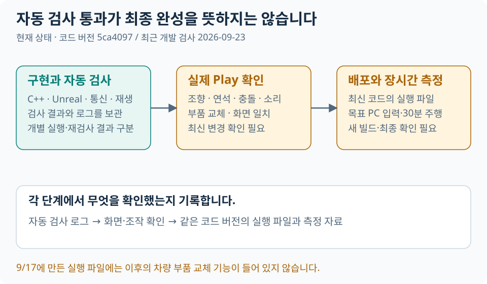

# 현재 상태와 남은 작업

문서 점검일과 최근 개발 검증일은 **2026-10-04**입니다. 구현 기준은 `5ca4097` 이후 작업 트리이며,
실시간 지면 비교·실험용 월드 측정 연결과 영어/한국어 README를 추가했습니다. 아직 커밋·푸시하지 않았습니다.
**구현됨·자동 검사 통과·실제 플레이 인수·연구 계획은 다른 상태입니다.**
지난 일정표의 완료 예정일을 실제 완료일로 사용하지 않습니다.

이번 작업에서는 **월드 변경 무효화 → 적용 측정 기록/재계산 → 선택형 상자 충돌·NPC 지면**을 연결하고 실제 서버·Unreal 통신 검사를 통과했습니다.
실제 Play에서의 연석·고속 인수, NPC 장애물 계획·구조물 초기 데이터의 전환, 파일 의존성 제거는 따로 남아 있습니다.
부품 선택을 포함한 기존 Play 인수는 유지합니다. 전체 보간·DB 연구는 전환과 동시에 진행하지 않습니다.
[전환 계획](architecture.md#실시간-월드-측정-전환-계획) · [기능 후속 작업](#모듈화-후속-우선순위) · [인수 목록](#기존-인수-작업) · [연구 순서](#연구개발-계획) · [검사 이력](#검증-실적)

## 실시간 월드 측정 전환

10/4 요청에 따라 **Unreal은 실행 중 지면·충돌을 측정하고, 서버는 그 결과로 자체 물리를 계산하는 방향**으로 계획했습니다.
비교 모드에 이어 **플레이어 지면 `-LiveGround`, 플레이어 주변 상자 충돌 `-LiveObstacles`, NPC·보행자 지면 `-LiveNpcGround`** 실험 모드를 연결했습니다.
기본 실행은 파일 기반입니다. 외부 차량 물리 SDK는 추가하지 않았습니다.
상세 계약·코드 변경 지점·단계별 완료 기준은 [아키텍처의 전환 계획](architecture.md#실시간-월드-측정-전환-계획) 한곳에서 관리합니다.

기준 확보 → 측정 비교 → 플레이어 지면 → 차체/정적 충돌 → NPC/동적 객체 → 통합 인수 순서입니다.
현재는 **2~4단계의 제한된 실험 입력을 연결한 상태**입니다. 전체 단계 인수나 기본 모드 전환 완료를 뜻하지 않습니다.
초기화·바퀴·차체 지면 조회와 선택한 NPC/장애물 조회는 실시간 측정을 씁니다.
겹친 지면·자유 낙하·일반적인 연석/고속 주행 인수는 남아 있습니다.

| 구분 | 10/4 착수 결과 |
|---|---|
| 구현 | `-GroundQueryShadow` 비교 유지. `-LiveGround` v3에서 625개 분할 측정과 최대 128개 연석 경계, 월드 버전 무효화, 실제 적용 측정의 재생 v2를 사용. 선택형 상자 충돌·공유 NPC 지면 타일 추가 |
| 안전 경계 | 플레이어 요청 생성부터 350ms 만료. NPC 타일은 같은 버전 알림 수명350ms를 추가 검사. 부족한 자료로 수행한 계산은 복원하고 제어권/상태 전송 유지. 선택한 실시간 조회를 파일로 자동 대체하지 않음 |
| 자동 검사 | 좌표·평지/경사·지면 없음·깊이별 결과, 상한·부분 응답·협상, 가속/회전/제동 600단계의 기존 물리 결과 보존 |
| 아직 남음 | 격자보다 작은 형상·확인되지 않은 복합 단차·다층 지면, 일반/기울어진 장애물 형상, NPC 장애물 계획·구조물 데이터 이관, 연석/고속·자유 낙하·부하별 인수, 최신 패키지·기본 모드 전환 |

실행 방법은 [지면 비교 검사](guides/core_validation.md#실시간-지면-측정-비교)와 [실험용 입력](guides/core_validation.md#실험용-플레이어-지면)에 있습니다.
완료일은 주행·부하별 비교 결과를 확인한 뒤 산정합니다. 기존 실제 Play 미인수 항목은 그대로 남습니다.

## 구현 범위

| 영역 | 구현한 내용 | 남은 경계 |
|---|---|---|
| 서버 연동 | WebSocket/Protobuf, 기본 60Hz 계산, 초기화·재연결·제어권 | 최신 패키지 장시간 안정성 |
| 실시간 지면 | 선택형 플레이어/NPC 지면·주변 상자 충돌, 월드 버전 무효화·측정 재생, 미측정 시 계산 복원 | 단층 지면·지원 상자용 실험. 일반 형상·고속/공중 인수와 NPC 장애물/구조물 파일 이관은 남음 |
| 플레이어 | 4개 차종, 조향·제동·서스펜션·접지·차체 충돌 | 실차 정밀 모델이 아님; 차종별 조작감 |
| 차량 데이터 | 부품 조립 도구·네 차종 공유 JSON·축별 타이어/서스펜션·동력 계산·정차 중 조합/개별 부품 선택 화면·NPC 동력/접지력 적용·재생/배포 연결 | 편집 기준 조합은 세단2종. 조합의 파일 저장·부품 질량 재합산·NPC 서스펜션 진동/바퀴 슬립은 미구현; 실제 Play 인수 필요 |
| 도심 | 교차로2곳, 59차로, 신호 head16개, 북쪽 루프·합류 안내 | 검증용 배경; 한국 도로 규칙 전체 재현은 아님 |
| 교통 | NPC10대·보행자8명, 목적지·우회·후진 복구·중앙선 비침범 | 센서 인식 AI가 아닌 규칙 기반; 주행 자연스러움 |
| 사고 | 차량·보행자·구조물 충돌, 국부 변형·전도·파편 | 금속 파괴·건물 전체 붕괴 모델은 아님 |
| 표시 | HUD·카메라3종·램프·경적·차량음·축약 실내·운전자 | 네 차종의 자세·문·소리·화면 인수 |
| 기록 | 시각 재생·서버 물리 재계산·접지/충돌 디버그 | 최신 실제 플레이와 배포 인수 |
| 관측 | 수신 간격·순번·신선도 로그, UE frame/state 캡처와 분석 | RTT·위치 보정량 계측, 지연 보간 비교, 비동기 분석 로그·DB는 후속 연구 |

## 차량 모듈화 진행 상태

### 차량 모듈화

아래 1~5단계와 개별 부품 선택은 구현한 내역입니다. 예제 데이터의 존재와 실제 주행 반영을 구분합니다.

1. **부품 파일·조립·검증:** 세단 예제 차체1개, 공용 부품11개(9종), 기본형/승차감형 조합2개를 추가했습니다.
   [설정 위치·계산·검사 방법](architecture.md#차량-부품-데이터--1단계)을 정리했습니다. 기존 주행은 변경하지 않습니다.
2. **기존 네 차종 이관:** 기준 cfg + 차종별 차이값으로 기존 계산 순서를 보존했습니다. 실행용 JSON에
   NPC·시각 설정도 모았고 서버 초기화·Hello 체크섬·Unreal 표시·재생 설정 식별·배포 파일을 연결했습니다.
   [실제 설정 위치와 한계](architecture.md#기존-네-차종-설정-이관--2단계)를 참고합니다. 주행 감각을 바꾸는 단계는 아닙니다.
3. **타이어·서스펜션 교체:** 앞·뒤 축의 부품 ID를 실제 타이어 힘·접지·스프링·댐퍼 계산에 연결했습니다.
   [설정 방법·적용 범위](architecture.md#타이어서스펜션-교체--3단계)를 참고합니다. 기본은 미지정 상태로 기존 값을 유지하며 파일 변경 후 재시작이 필요합니다. 실제 조작감 인수는 남아 있습니다.
4. **엔진·변속기·연료:** 선택한 부품의 토크 곡선·관성·자동 변속·구동축 토크·리터 단위 연료 소비를 자체 계산기에 연결했습니다.
   [선택 방법·계산 범위](architecture.md#엔진변속기연료--4단계)를 참고합니다. 기본은 `powertrain_modules: null`로 기존 모델을 사용하며,
   새 계산은 네 동력 부품과 변속 정책을 명시했을 때만 적용됩니다. 실차 토크컨버터·엔진 브레이크·연료 질량 변화는 계산하지 않습니다.
5. **교체 UI·NPC 적용:** `G`로 사전 정의 부품 조합을 고르고 정차 후 새 PlaySession으로 적용합니다.
   [화면·데이터·NPC 적용 범위](architecture.md#부품-조합-선택-화면npc-적용--5단계)를 참고합니다.
   세단의 기본 부품형·승차감 비교형을 제공하며 나머지 세 차종은 기존 기본값을 유지합니다.
   같은 차종 NPC는 선택 조합의 엔진·변속·연료와 타이어/도로별 구동·제동 한계를 공유합니다.
   NPC는 경로 추종을 유지하므로 플레이어와 같은 서스펜션 진동·바퀴 슬립 모델은 아닙니다.
   9/23에는 `Tab`으로 앞/뒤 타이어·앞/뒤 서스펜션·엔진·변속기·구동계·연료탱크를 각각 고르는 편집 화면을 추가했습니다.
   [개별 부품 사용법·호환 조건](architecture.md#개별-부품-선택)을 참고합니다. `Enter`로 적용할 때만 서버가 초기화하며, 미적용 초안은 닫으면 버립니다.
   현재 동력 부품은 종류별1개이며, 등록하지 않은 부품이나 다른 차종 조합을 자동 생성하지 않습니다.

### 모듈화 후속 우선순위

1. **실제 Play 확인:** 세단 프리셋을 기준으로 앞 타이어만 바꾸고 적용·취소·재열기·기록 재생을 확인합니다. 화면 가독성과 주행 차이는 직접 확인해야 합니다.
2. **차종별 부품/조합 데이터:** 경차·트럭·오토바이용 호환 부품과 비교 조합을 추가합니다. 개별 편집 기능은 준비되어 있지만 비교 데이터는 아직 세단 중심입니다.
3. **질량·무게중심·관성 반영:** 부품 교체에 따른 총질량 등을 다시 계산합니다. 지금 표시하는 부품 질량은 정보이며 차체 질량을 자동 변경하지 않습니다.
4. **선택 확장:** 사용자 조합 파일 저장, NPC 서스펜션/슬립, SUV·버스는 별도 범위로 정합니다.

SUV·버스 카테고리는 구분할 수 있지만 차량 모델·설정·다축 물리가 추가된 것은 아닙니다.
외부 물리 SDK는 추가하지 않았습니다. 부품 미지정 차량은 기존 운전 특성을 유지하며, 부품을 선택하면 해당 계산값이 달라집니다.

### 기존 인수 작업

1. **Play 인수:** 네 차종의 조향·후진·연석 재출발·전복/충돌·카메라·HUD·소리·기록 재생을 확인합니다.
2. **NPC 복구:** 앞길 차단, 우회 도중 차단, 후방 차단을 비교합니다. 중앙선을 넘지 않고 가능한 공간에서 움직여야 합니다.
3. **배포본 확인:** revision을 고정해 새 패키지를 만들고 다른 경로/PC에서 실제 화면과 입력을 확인합니다.
4. **입력·성능:** 목표 PC 1080p 환경의 입력 영상과 30분 주행 기록을 측정합니다. 자동 검사나 NullRHI로 대신하지 않습니다.
5. **공유 자료:** 인수한 빌드 기준으로 실제 영상·대표 이미지·포트폴리오 설명을 맞춥니다.

기존 9/7 Core·9/11 확장 목표는 지난 계획이며 미인수 상태였습니다. 확정 완료일은 없습니다.
인수 결과와 수정량을 확인한 뒤 완료일을 정합니다. 요청한 모듈화 작업과 별개로 위 인수는 계속 필요합니다.

## 연구개발 계획

Drive Telemetry Lab은 **후속 연구 계획**입니다. 현재 물리 재생·통신 복구·성능 캡처는 재사용하고,
없는 기능만 추가합니다. 아래 순서는 의존 관계이며 완료일이나 측정 결과가 아닙니다.

| 순서 | 할 일 | 다음 단계로 넘어갈 기준 |
|---|---|---|
| 1 | 기준 시나리오·revision·맵·차종/부품·입력·카메라 조건 고정 | 현재 코드의 원시 로그와 영상 확보, 미측정 지표 표시 |
| 2 | 최소 계측 보완 | RTT·수신 나이·입력 적용·화면 반응 구분, 세션/순번으로 로그 연결, 누락 원인별 집계 |
| 3 | 표시 방식 비교 | 최신 상태+최대 50ms 예측을 기준으로 50/100/150ms 보간 후보 비교. 플레이어 반응성과 NPC 부드러움을 각각 판정 |
| 4 | 로그 부하와 복구 실험 | 유한 크기 큐·별도 쓰기 작업의 효과, 적체/단절/오래된 상태 처리와 데이터 누락 확인 |
| 5 | 결과 분석·공유 | 로컬 파일/SQL 분석으로 결론 작성. PostgreSQL·Grafana·Docker·클라우드는 필요할 때 별도 확장 |

보간 버퍼·RTT 계측·일반 분석용 비동기 exporter·DB 대시보드는 아직 구현하지 않았습니다.
100ms 버퍼가 더 좋다거나 성능이 개선됐다고 미리 결론 내리지 않습니다.
실험 조건·시계·데이터 보존 규칙은 [검증 방법](guides/core_validation.md#연구-실험-절차),
기존 구조와 확장 경계는 [시스템 구조](architecture.md#관측과-연구-확장)를 기준으로 합니다.

현재 우선하는 실시간 월드 측정 전환에는 기준 측정과 필요한 최소 계측만 먼저 사용합니다.
후속 연구 결과를 전환 이전 기준과 섞지 않으며, 보간·DB 비교는 전환 상태를 고정한 뒤 진행합니다.
차종 데이터 확장과 질량 재계산은 별도 기능 작업이며 연구 시작에 모두 필요한 선행 조건은 아닙니다.
개인 학습 날짜·시간은 프로젝트 외부 연구 계획에서 관리하고, 이 문서에는 실제 구현·검증 결과만 누적합니다.

## 검증 실적

검사를 수행한 시점별 결과입니다. 문서 정리 당시의 검사와 이후 차량 데이터 이관 검사를 구분합니다.
자동 검사 통과가 실제 Play 화면·조작감 인수를 대신하지는 않습니다.

| 시점 | 검사 | 결과 |
|---|---|---|
| 10/4 | 월드 측정 전환 서버 | 최종 Release 전체 빌드 성공. 단일 CTest62/62 통과(452.71초). 새 지면/장애물/NPC·협상·유효기간·되돌리기·측정 재생과 기존 차량/NPC 회귀 포함 |
| 10/4 | 월드 측정 전환 Unreal | Editor/Game 빌드 성공. 수정 후 전체 자동 검사138/138 통과(기존 경고7개 포함). 월드 변경·중간 스캔 취소·상자 실측·독립 NPC 타일·표시용 디버거 제외 검사 포함 |
| 10/4 | 실제 측정 기록 재생 | 저장된 L_SignalCity를 NullRHI로 실행. 최종 빌드의 전체 옵션에서 2,400프레임 기록·재계산 위치/방향 오차0. 플레이어5.45m 이동, 준비 후 NPC·보행자18개 유지, NPC 최대81.57m 이동. 렌더링/조작감 인수는 아님 |
| 10/4 | 응답 누락 복구 | 1초간 플레이어 지면 응답3개를 누락. 요청3개 만료 후 같은 연결에서 재개, 객체18개 유지. 시험 종료 후 클라이언트 종료 로그는 판정에서 제외 |
| 10/4 | 실제 연석 방향 조회 | 방향90°·제한된 가속 입력에서31.13m 이동, 최고10.82m/s, 장애물2개 실측 전송. 정상 응답은 모두64KiB 미만. 관통/전복/모든 진입각의 수동 인수를 대신하지 않음 |
| 10/4 | 기존 파일 모드 회귀 | 신호 전체 주기7,080상태·차량10/보행자8·SafeStop·같은 Play 복구·새 Play 초기화 통과. 별도480프레임 실제 입력 재생 위치/방향 오차0 |
| 10/4 | 도구와 실행 구성 | 도구 단위 검사123/123·Protobuf 생성 일치·서버 실행기·Windows 패키지 계획 검사 통과. 새 Cook/배포본을 만든 것은 아님 |
| 9/17 | C++ Release 빌드 | 성공 |
| 9/17 | CTest48개 | 최초47개 통과. 재생 시험 시간값 자료 수정 후 나머지1개 재검사 통과. 단일48/48 보고서는 아님 |
| 9/17 | Unreal Editor/Game·Automation | 빌드 성공, 114개 성공(무경고105·경고 포함9) |
| 9/17 | 실제 서버 통신·지도·재생 | 상태7,080개, NPC·보행자·신호·SafeStop·세션 복구/초기화·물리 재생 통과 |
| 9/17 | Windows 패키지 | 빌드·Cook·구성, 외부 경로에서 파일95개 해시·설정·상태 수신 확인. NullRHI이며 화면 인수 아님 |
| 9/19 | 미사용 구성 제거 후 C++ | 영향 대상 빌드·관련 CTest8개 통과. 전체48개 재실행은 아님 |
| 9/19 | 개발 검사 도구 | 103/103, Protobuf 생성1/1, Windows 패키지 계획 검사 통과 |
| 9/19 | 격리 서버 통신 | 제어·SafeStop·제어권 만료·재연결·EStop 유지 통과 |
| 9/19 | 차량 모듈화 1단계 | 검사 도구·테스트 Release 빌드 성공. CTest5개 통과: 조립 검증40사례, JSON 경계 검사, 예제 카탈로그 검사, 기존 차량 설정·오토바이 회귀. 전체 CTest/Unreal 재검사는 아님 |
| 9/19 | 차량 모듈화 2단계 빌드 | C++ Release 전체 및 Unreal Editor/Game Development 빌드 성공 |
| 9/19 | 2단계 전체 CTest | 단일 실행52/52 통과. 플레이어·NPC·차종 초기화·재생·통신 회귀 포함 |
| 9/19 | 2단계 기존 값 보존 | 런타임 카탈로그15사례 통과. 네 차종의 기존 물리65필드·NPC13필드 비교, 기준 cfg 및 사용자 기준값 상속 확인 |
| 9/19 | 2단계 Unreal Automation | 116개 성공(무경고106·경고 포함10), 실패0. 시각 설정·카탈로그 검증·Hello·재생 포함 |
| 9/19 | 2단계 개발·배포 검사 | Python 검사113/113, Windows 패키지 계획·파일 검증 테스트 통과. 새 Cook/패키지는 만들지 않음 |
| 9/19 | 2단계 실제 통신·물리 재생 | 설정 체크섬·SafeStop·제어권 만료·재연결·EStop 통과. 480프레임·초기화2회·동적 충돌체480프레임 기록 재계산, 위치·방향 오차0 |
| 9/19 | 차량 모듈화 3단계 서버 빌드·부품 검사 | C++ Release 전체 빌드 성공. 런타임 카탈로그32사례·축별 물리9사례 통과. 기본형 수치/주행 유지, 축별 스프링·댐퍼·접지력·바퀴 반지름·진동 감쇠·접지 한계 확인 |
| 9/19 | 3단계 전체 CTest·Unreal 빌드 | 단일 실행53/53 통과. Unreal Editor/Game Development 빌드 성공 |
| 9/19 | 3단계 Unreal Automation | 최종 전체 실행119개 성공(무경고110·경고 포함9), 실패0. 새 부품 선택·오류 검증·축별 접지/회전 표시3개 포함 |
| 9/19 | 3단계 실제 통신·재생 | 격리 서버 연결·안전 정지·재연결 통과. 실제 통신480프레임 물리 재생 위치·방향 오차0. 별도 단위 검사에서 앞축 부품 선택을 포함한 네 차종 초기화·재생 확인 |
| 9/19 | 3단계 개발·배포 검사 | Python117/117, Windows 패키지 계획·부품 파일 해시/누락/잘못된 경로 검사 통과. 새 Cook/패키지·실제 Play 인수는 하지 않음 |
| 9/19 | 차량 모듈화 4단계 빌드·부품 검사 | C++ Release 전체 및 Unreal Editor/Game Development 빌드 성공. 런타임 카탈로그48사례, 엔진·변속·연료 물리9개 묶음 통과 |
| 9/19 | 4단계 전체 CTest | 단일 실행54/54 통과(437.40초). 기존 차량·NPC·사고·접지·통신·재생 회귀 포함 |
| 9/19 | 4단계 Unreal Automation | 최종 전체 실행121개 성공(무경고112·경고 포함9), 실패0. 동력 부품 선택·연료/토크/변속 조건·수치 정밀도 검사 포함 |
| 9/19 | 4단계 통신·물리 재생 | 실제 통신480프레임·초기화2회 재계산 위치·방향 오차0. 별도 선택 부품1200프레임 검사에서 변속·연료·중립/후진·초기화 재생 일치 |
| 9/19 | 4단계 개발·배포 검사 | Python119/119, Windows 패키지 계획·파일 검증 통과. 새 Cook/패키지·실제 Play 인수는 하지 않음 |
| 9/19 | 차량 모듈화 5단계 C++ | Release 전체 빌드 성공, 단일 CTest56/56 통과(446.04초). 조합 검증·이동 중 교체 거부·재연결·동일 차종 NPC 공유·NPC 동력/접지력 7개 묶음·기존 주행 회귀 포함 |
| 9/19 | 5단계 Unreal 빌드·Automation | Editor/Game Development 빌드 성공. 최종 전체127개 성공(무경고118·경고 포함9), 실패0. 조합 선택 조건·서버 확인·5초 확인 지연 재연결·NPC 표시·CSV v3 재생 포함 |
| 9/19 | 5단계 실제 통신·물리 재생 | 기본 부품형→같은 Play 재연결→승차감형→기본값 복구 통과. 실제 통신480프레임 재계산 위치·방향 오차0. 별도 조합 선택600프레임 재생 검사 통과 |
| 9/19 | 5단계 개발·배포 검사 | Python123/123, Protobuf 생성1/1, Windows 패키지 계획·조합 파일 포함/경로 검사 통과. 새 Cook/패키지·실제 Play 인수는 하지 않음 |
| 9/23 | 개별 부품 선택 빌드·집중 검사 | C++ Release 전체 및 Unreal Editor/Game Development 빌드 성공. 관련 CTest5개 통과: 런타임 카탈로그70사례, 조합/제어권 수명, Protobuf, 서버, 사용자 구성360프레임 재생 포함 |
| 9/23 | 개별 부품 선택 전체 CTest | 최초55/56 통과(447.43초). Unreal 빌드/검사 병행 중 기존 NPC 탐색 검사1개가45초 제한에 걸렸으며, 다른 검사 종료 후 단독 재실행에서41.67초로 통과. 제한값 변경 없이 확인했으며 단일56/56 보고서는 아님 |
| 9/23 | 개별 부품 선택 Unreal Automation | 전체132개 성공(무경고122·경고 포함10), 실패0·미실행0. 8개 항목 편집·취소·재열기, 부품 호환/하중/기하 검사, 기능 협상·체크섬·재생 경계 포함 |
| 9/23 | 개별 부품 선택 실제 통신 | 기본 부품형→재연결→앞 타이어만 교체→재연결→승차감형→기본값 복구의6단계 통과. 선택 ID 확인, 초기 연료70%, 같은 Play 재연결 시 연료 보존, 기본값 복구 확인 |
| 9/23 | 개별 부품 선택 개발·배포 검사 | Python123/123, Protobuf 생성1/1, Windows 패키지 계획·파일 검증 통과. 새 Cook/패키지·실제 Play 인수는 하지 않음 |
| 10/4 | 지면 비교 빌드·서버 집중 검사 | 서버와 영향 대상 4개 테스트 타깃 Release, Unreal Editor/Game Development 빌드 성공. CTest4/4 통과(1.12초): 지면 비교·실행 옵션·프로토콜·서버. 전체 CTest 재실행은 아님 |
| 10/4 | 지면 비교 개발 도구 | Python123/123, Protobuf 생성1/1 통과 |
| 10/4 | 지면 비교 Unreal Automation | 최종 전체134개 성공(무경고127·경고 포함7), 실패0·미실행0. 전체 Envelope에서 지면 요청 보존, oneof 판별, 측정 좌표/높이 변경 및 기존 기능 회귀 포함 |
| 10/4 | 실제 Unreal–서버 지면 비교 | 격리 포트·Signal City·기본 세단 정지·NullRHI·60fps 제한. 측정157회/접촉785개, 거부·만료·측정 실패·접촉/재질 불일치0. 높이/법선 최대 차이0. 요청 준비→응답 최대46.63ms, 마지막30.27ms; 마지막 UE 측정0.0381ms. 고속 주행·렌더링 성능 결과가 아님 |
| 10/4 | 실제 조회 비교 v2 빌드·자동 검사 | 영향 C++ Release, Unreal Editor/Game Development 빌드 성공. 관련 CTest4/4(1.04초), Python123/123, Protobuf1/1, Unreal134개 성공(무경고127·경고 포함7). 전체 CTest/새 패키지는 실행하지 않음 |
| 10/4 | v2 기존 주행 보존 | 평지·가속/조향/제동 600단계에서 관찰 켜기/끄기의 모든 공개 물리 필드 일치. 호출 시각 메타데이터는 제외. 단계당 최대157회 조회/고유49개, 수집 제외0 |
| 10/4 | v2 실제 정지 연결 | Signal City·세단·NullRHI·60fps 제한, 측정156회/접촉5,874개. 판정 시점 거부·만료·실패·불일치0. 응답 p95 36.68ms, UE 측정 p95 0.179ms |
| 10/4 | v2 짧은 이동 연결 | 같은 맵/차종·시험용 로컬 중계에서 4초 가속과 짧은 조향 후 제동. 최대2.47m/s·스폰에서5.41m, 측정157회/접촉6,453개, 최대49지점·깊이24m. 판정 시점 거부·만료·실패·불일치0. 응답 p95 40.85ms, UE 측정 p95 0.203ms |
| 10/4 | 실험용 지면 서버 회귀 | C++ Release 전체 빌드, CTest58/58 통과(445.32초). 이후 경사 초기화 측정 높이를 6→8m로 보완하고 최신 플레이어 지면 집중 검사·UE 연계·실제 통신을 다시 통과. 전체 58개를 보완 후 다시 실행한 결과는 아님 |
| 10/4 | 실험용 지면 Unreal·도구 | Editor/Game Development 빌드 성공. 최종 Unreal135개 성공(무경고128·경고 포함7), 실패0·미실행0. Python123/123, Protobuf1/1, Windows 서버 실행 도구 검사 통과 |
| 10/4 | 실제 UE 측정의 물리 적용 | 별도 월드에서 같은 바닥을 0.2m→0.8m→15도 경사로 수정, Bake 없이 생성한 응답을 C++에서 역직렬화. 같은 차량을 유지해 각각20틱 계산 후 차체 높이0.7485m→1.3554m, 경사 단계 pitch14.26도 확인. 저장된 응답 연계 검사이며 실제 화면 인수는 아님 |
| 10/4 | 실험용 지면 정상 통신 | Signal City·세단·NullRHI·60fps 제한·시험용 입력 중계. 최종 측정100회, 계산650틱, 최대2.386m/s·5.051m 이동. 거부/요청 만료0, 연결1회, NPC·보행자 최소18개 유지. 최대 응답40,151바이트로 기존64KiB 제한 안에 있음 |
| 10/4 | 측정 응답 누락 복구 | 조작/상태 전송은 유지하고 측정 응답만1초 차단. 응답3개 폐기·요청3회 만료, 새 결과 후 계산 재개. 측정102회·계산670틱, 연결1회·NPC/보행자18개 유지. 화면 깜빡임/조작감 인수를 대신하지 않음 |
| 10/4 | 실시간 지면 단차·범위 보완 | 영향 C++ Release 및 Unreal Editor 빌드 성공. 관련 CTest4/4, Python123/123, Protobuf1/1 통과. Unreal 전체136개 통과 후 완만한 경사 위 연석 처리를 보완하고 관련2개 재검사 통과. 전체 CTest·Game 빌드·새 패키지는 이번 보완 후 재실행하지 않음 |
| 10/4 | 연석·경사 경계 자동 검사 | 단차 양방향·대각선·이동된 격자·재질 경계·30~50도 경사 시작점·격자와 일치하는 경계 확인. 2% 경사와 2m 간격에서도 UE가 연석 경계24개 검출. 위조 경계·혼합 NoHit·만료·구형 live v1 거부 확인 |
| 10/4 | UE 연석 측정과 서버 물리 연계 | UE가 측정한 높이0/0.2m·경계 east=0.25m 응답을 C++에서 읽고 같은 정적 측정값을 갱신하여 차량 이동. 계산167틱 모두 성공, east=3.007m·차체 높이0.749m. 접촉점이 두 실제 높이에만 놓이는지 확인. 저장 응답 연계 검사이며 실제 화면 인수 아님 |
| 10/4 | 지연된 측정과 이동 범위 | 합성 평지 응답에 100/125/150ms 지연 적용. 실제 차량 계산 전진600틱·164.41m·최고29.61m/s, 후진600틱·64.42m·최고8m/s, 각77회 측정 갱신에서 초기화 뒤 계산 보류0. 별도 범위 검사로 50m/s 전진·후진·옆미끄러짐의 차체 주변 조회 확인. 실제 UE 고속 렌더링/충돌 인수와 구분 |
| 10/4 | 보완 후 실제 통신·누락 복구 | Signal City·세단·NullRHI·60fps 제한·시험 입력 중계. 정상 측정101회/계산714틱·최대2.417m/s·5.184m, 거부/만료0. 측정 응답1초 차단 시험에서는 응답3개 폐기·요청3회 만료 후 측정103회/계산734틱까지 복구. 두 시험 모두 연결1회·NPC/보행자 최소18개 유지, 판정 시 최대 응답40,151바이트 |

9/17 패키지는 미커밋 변경을 포함한 개발 후보이며 `assembled_unverified`,
`manual_acceptance=not_run`입니다. 현재 정리된 소스의 새 배포본이 아닙니다.
원시 로그·후보·상세 결과는 [외부 보관 자료](README.md#이전-자료)에 있습니다.
2단계의 새 검사 로그는 로컬 `runtime_logs/vehicle-catalog-stage2-*`와
`runtime_logs/physics-replay-20260919-151324-4bd12200.replay`에 남겼습니다.
이 로그와 자동 검사 보고서는 Git에 포함하지 않습니다. 이번 변경의 실제 Play 인수는 아직 진행하지 않았습니다.
3단계 결과는 `runtime_logs/vehicle-catalog-stage3-*`, 실제 통신 재생은
`runtime_logs/physics-replay-20260919-153104-f338d5f0.*`에 남깁니다.
Unreal 최종 실행 로그는 `vehicle-catalog-stage3-automation-final.log`입니다.
검사 준비 중의 캐시 경로 문제와 새 테스트 자료 생성 오류를 수정한 뒤 전체를 다시 실행한 결과입니다.
4단계 결과는 `runtime_logs/vehicle-catalog-stage4-*`, 실제 통신 재생은
`runtime_logs/physics-replay-20260919-155339-cb4cb4dc.*`에 남겼습니다.
Unreal 최종 실행은 `vehicle-catalog-stage4-automation-final` 보고서 기준입니다.
5단계 서버 결과는 `runtime_logs/vehicle-catalog-stage5-ctest.xml`, 조합 선택 실제 통신은
`runtime_logs/health-smoke-20260919-161356-626655cb.*`, 물리 재생은
`runtime_logs/physics-replay-20260919-161847-0166f87a.*`에 남겼습니다.
Unreal 최종 실행은 `runtime_logs/vehicle-catalog-stage5-automation-final` 보고서 기준입니다.
처음 추가한 서버 검사 자료의 경로 구간 길이·예제 초기 연료 기대값을 바로잡은 뒤 전체를 재실행했습니다.
Unreal의 격리 테스트 월드 정리 등에 따른 경고는 위 성공 개수와 별도로 표시했습니다.
9/23 개별 부품 선택 결과는 `runtime_logs/parts-editor-*`, 실제 통신은
`runtime_logs/health-smoke-20260923-160131-9f32a714.*`에 남겼습니다.
Unreal 결과는 `runtime_logs/parts-editor-automation/index.json` 기준이며 NullRHI 검사입니다.
서버 전체 검사는 `parts-editor-ctest.xml`, 시간 제한에 걸린 항목의 단독 재검사는 `parts-editor-ctest-retry.xml`로 구분합니다.

10/4 비교 기능의 서버 결과는 `runtime_logs/ground-shadow-ctest.xml`, 최종 빌드는
`runtime_logs/ground-shadow-build-final/`, 실제 통신은 `runtime_logs/ground-shadow-live-final/`에 있습니다.
최종 Unreal 결과는 `runtime_logs/ground-shadow-post-wire-fix/ue-automation/index.json`이며 134개 모두 수행했습니다.
첫 실제 연결 검사에서 요청이 대상 차량 상태를 복사할 때 빠지는 문제를 발견했습니다.
요청 보존과 전체 Envelope 회귀 검사를 추가한 뒤, 동일 조건에서 위 157회 응답을 확인했습니다.
첫 실패 로그는 `ground-shadow-live/`에 구분해 보존합니다. 새 자동 검사의 임시 월드 이름 충돌도 수정했습니다.
짧은 정지 검사에서 측정된 최대 지연을 전체 주행의 p95나 성능 개선으로 해석하지 않습니다.
실제 Play·연석 주행·지형 변경 전체 흐름·비교 모드 켜기/끄기 성능 기준선·새 패키지는 아직 확인하지 않았습니다.

실제 조회 비교 v2 결과는 `runtime_logs/ground-capture-stage2/`, 직접 정지 연결과 시험용 중계를 통한
짧은 이동은 각각 `runtime_logs/ground-capture-stationary/`, `runtime_logs/ground-capture-moving/`입니다.
중계는 격리 시험의 조작만 주입하며 실제 게임 코드·사용자 맵·개인 설정을 바꾸지 않았습니다.
p95는 해당 실행의 정상 응답 표본 기준이며 중계/NullRHI 조건을 포함합니다. 정상 렌더링이나 고속/연석 성능 수치가 아닙니다.
통신 판정은 `summary.json` 시점입니다. 검사용 클라이언트를 종료한 후 기록된 disconnect·제어권 timeout은 시험 종료와 구분합니다.
초기 C++ 비교 검사의 벽시계 타임스탬프 차이는 물리 수치가 아니므로 정규화하고 나머지 전체 공개 상태를 다시 비교했습니다.

실험용 물리 입력의 최종 검사는 `runtime_logs/live-ground-stage2/`에 보관했습니다.
`ue-ground-to-physics.log`는 Unreal이 만든 세 가지 응답을 같은 차량 계산에 적용한 결과입니다.
초기 경사 검사에서 지붕 조회가 측정 상단을 벗어나는 문제를 찾아 높이 여유를 보완했습니다.
최종 실제 통신은 `runtime_logs/live-ground-moving-final/summary.json`,
누락 시험은 `runtime_logs/live-ground-loss/summary.json` 기준입니다.
`waits`에는 Unreal이 아직 실행되지 않은 서버 시작 구간도 포함됩니다. 정상 연결 시험에서는 초기 측정 뒤 추가 보류가 없었습니다.
시험 종료 후 disconnect/timeout은 판정 구간 밖입니다. 수동 Play·장시간·고속·연석·월드 변경 revision·새 패키지는 미인수입니다.

이번 단차·범위 보완의 서버 검사와 UE 측정 연계 결과는 `runtime_logs/live-ground-v2/`,
Unreal 검사와 실제 측정 응답은 `runtime_logs/live-ground-v2-ue/`에 있습니다.
실제 통신 판정은 `runtime_logs/live-ground-v2-moving/summary.json`과
`runtime_logs/live-ground-v2-loss/summary.json` 기준이며 시험 종료 중의 만료·연결 종료 로그는 제외합니다.
위의 합성 평지 지연 시험은 측정 범위 검증이며 고속 연석 충돌·관통 방지 전체를 검증한 것은 아닙니다.
이후 월드 변경 감지·무효화와 측정 재생, 선택형 장애물/NPC 지면을 이어서 구현했습니다.
기본 모드와 기존 Bake 파일은 유지합니다. 최신 범위는 문서 상단을 기준으로 합니다.

이번 월드 측정 전환의 전체 서버 검사·기존 실행 회귀는 `runtime_logs/live-world-final/`,
Unreal 최종 자동 검사는 `runtime_logs/world-obstacle-render-helper-qa/`에 있습니다.
실제 주행/재생은 `runtime_logs/live-world-v3-moving-obstacles-npc-record-1791104576958560600/summary.json`,
누락 복구는 `runtime_logs/live-world-v3-moving-obstacles-npc-loss-1791104305815877800/summary.json`,
연석 방향 조회는 `runtime_logs/live-world-v3-moving-obstacles-npc-curb-1791104349511790000/summary.json` 기준입니다.
실제 저장 맵 시험에서 표시 전용 Gameplay Debugger 컴포넌트의 장애물 오인과 격자선에 겹친 연석 경계의 거부를 발견해 수정했습니다.
전자에는 실제 물리 Body가 없는 디버그 컴포넌트만 제외했고, 후자에는 측정된 두 높이와 경계 방향 검사를 유지했습니다.
시간 제한·프레임 크기·허용 오차를 넓혀 통과시킨 수정은 아닙니다. 두 사례를 자동 검사에 추가했습니다.

## 문서 관리

원본51개를 외부에 보관하고 현재 문서11개로 정리했습니다. 일정·기능·검증 결과는 이 문서에,
구조는 `architecture.md`에 모읍니다. 일일 기록·폐기한 계획·중복 설명은 외부에서 복구할 수 있습니다.
에셋 출처는 유지했습니다. 9/19 정리 당시 실행 코드·지도·에셋과 실행 중이던 서버는 변경하지 않았습니다.

전체 폴더 후속 정리에서는 과거 Chrono 실험과 Unreal의 이전 검사·패키징 산출물 등
1,771개 파일(1,719,178,981바이트)을 외부 `project_cleanup/`에 옮기고 SHA-256을 확인했습니다.
빈 폴더414개를 제거했습니다. 사용자 자동 저장본·주행 기록·스크린샷·개인 설정과 실행/빌드에
필요한 파일은 유지했습니다. 당시 서버가 실행 중이어서 C++ 빌드 영역의 진단 자료는 이동하지 않았습니다.
정리 후 실행 준비 검사와 문서 링크 검사를 통과했으며, 빌드·전체 테스트를 재실행한 것은 아닙니다.

10/4에는 현재 코드와 후속 연구 계획을 대조해 문서의 구현/계획 구분, 부품 사용법·배포 구성,
측정 정의와 관리 기준을 갱신했습니다. 과거 검사 수치와 에셋 반입 이력은 보존했습니다.
같은 날 설명 도식 10개를 추가하고 README를 요약했으며, 상세 검사 이력을 후속 작업 뒤로 옮겼습니다.
핵심 설명과 그림 문구도 쉬운 표현으로 바꿨습니다. `MapPackage`는 설명에서 ‘서버용 맵 데이터’로
부르고, 영어 설명용 용어와 이 데이터가 필요한 이유를 추가했습니다. 코드 이름·파일 형식은 유지했습니다.
저장소 Markdown 21개의 내부 파일·목차·이미지 링크 219개와 변경분 공백 검사를 통과했습니다.
도식 10개와 주요 문서 4개를 로컬에서 렌더링해 이미지 누락·잘림·가로 넘침이 없음을 확인했습니다.
위 문서 정리 시점에는 C++/Unreal 빌드·게임 자동 검사·실제 Play를 새로 실행하지 않았습니다.
이후 실시간 월드 측정 전환 계획과 구조 그림 1개, 영어 기본/한국어 별도 README 구성안을 추가했습니다.
이때 수정한 문서 3개의 내부 링크 116개와 변경분 공백을 검사했고, 도식 11개·문서 5개 미리보기에서
이미지 누락·가로 넘침이 없음을 확인했습니다. 계획 수립 시점에는 실행 코드와 README 번역을 변경하지 않았습니다.
이후 전환 착수에서는 비교 기능을 추가하고 `README.md`를 쉬운 영어로 작성했으며,
같은 범위의 `README.ko.md`와 언어 전환 링크를 추가했습니다. 공용 구조 그림도 영어로 맞췄습니다.
Markdown22개의 내부 파일·목차·이미지 링크244개와 공백 검사, 도식11개·문서6개 렌더링을 확인했습니다.
현재 구현·검사와 남은 인수는 이 문서 상단 및 검증 실적에 구분했습니다.
월드 측정 전환 후에도 영어/한국어 README·기술 문서·구조 그림을 갱신했습니다. 주요 Markdown13개의
내부 파일/이미지 링크199개, 문서6개·도식11개의 이미지 누락/가로 넘침 검사와 변경분 공백 검사를 통과했습니다.
문서별 갱신 시점은 [관리 기준](README.md#주기적으로-관리할-문서)을 따릅니다.
